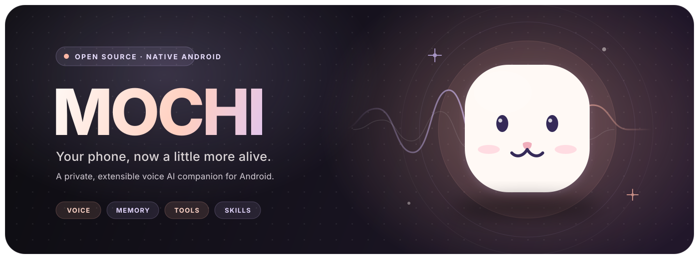

# Mochi

**An AI companion for your Android phone. Talk, plan your day, research the web,
and get things done with the model you choose.**

[**Download APK**](https://github.com/gongpx20069/hi-mochi/releases/latest)
· [**Watch introduction (Chinese)**](https://www.bilibili.com/video/BV1u6aB6GEDD/)
· [English](README.md) · [简体中文](README.zh-CN.md)

**Android 8.0+ · Bring your own model API key · No Mochi account required**

---

Give a spare phone a place on your desk, or use Mochi on your everyday phone.
Type a question, dictate a message, or say **“Hi Mochi”** in Companion mode.
Your conversations, planner and settings live on your device; AI requests use
the provider you configure.

[Get started](#get-started) · [What you can do](#what-you-can-do) ·
[Connect services](#connect-services) · [Optional extensions](#optional-extensions) ·
[Privacy and control](#privacy-and-control)

## Get started

1. **Install Mochi** from [GitHub Releases](https://github.com/gongpx20069/hi-mochi/releases/latest).
   Choose `arm64-v8a` for most phones, or `universal` if unsure.
   Older ARM devices use `armeabi-v7a`; Intel devices and emulators use `x86_64` or `x86`.
   All packages have the same features. Keep the same signing channel when updating;
   there is no need to uninstall.
2. **Connect a model** in **Settings > AI connections > Add AI connection**.
   Choose a provider, follow its registration/key guide, and enter an available
   model that supports tool calling. You need your own provider API access;
   a consumer chat subscription does not necessarily include it.
3. **Start talking or typing.** In **Chat**, tap the input to type or hold to
   dictate. Release adds words to your draft; tap Send when ready.
   In **Companion**, grant microphone permission and use the selected wake phrase.
   Connect other services only when you need them.

Android speech is built in; no separate speech API key or extension APK is
required to start. Recognition and installed voices depend on the phone.
If setup is unclear, **Settings > Configuration check** checks the model connection
and related configuration. It sends a short model request that may consume quota.

## What you can do

### Chat, or keep a companion on your desk

**Chat** and **Companion** share your conversation history. Chat supports typing,
hold-to-dictate and a reply-mute button. Companion shows Mochi's expressions and
supports spoken replies and follow-up listening. Full screen gives Mochi, the
date and the time more room on a desk display.

Choose **“Hi Mochi”** or **“老莫老莫”** in **Settings > Speech and wake**.
Wake listening works only while Companion is visible, the app is in the
foreground and the screen is unlocked—not while locked or in the background.
You can also choose English or Chinese UI and edit Mochi's personality in Settings.

### Plan your day and remember what matters

Ask Mochi to create schedules, manage dated todos, show a day's agenda or set
up a recurring Agent task. For example:

> “Remind me about my appointment tomorrow at 3.”
>
> “Every morning, research this topic and summarize what you find.”
>
> “What did we decide about the trip last week?”

Calendar reminders and scheduled Agent tasks are different: one reminds you of
an event, while the other asks the model to do work and saves its result to chat.
Use **Tasks** to inspect schedules, execution results and connected extension tasks.
Notifications and Android background restrictions affect delivery and timing.

Conversation history stays on the phone. Optional **Daily journal** and
**Memory Recall** help find past details and their original messages; they are
off by default. Relevant history may be included in requests to your model.

### Research the web and browse yourself

Ask Mochi to read a link, compare products, research travel options or summarize
public information. Its browser can reuse local website sessions and ask you
to handle login or verification when needed.

For manual browsing, tap **Browse** in the Chat or Companion header, or open
**Tools > Agent Browser > Websites and logins**. Search, enter an address, and
manage saved website accounts there. The browser has Back, Forward, Home and
Sites controls. Home keeps the page available through **Return to page**;
Close ends manual browsing.

Passwords are stored locally with encryption and are not sent to the model.
SMS accounts save a website and phone number, never verification codes.
Enter credentials in the website or its native account dialog, not in chat.
Agent web research in Chat does not automatically open an interactive page for you.

### Work with your documents and apps

Connect **Notion**, **Tencent Docs** or **Feishu** to find your own material,
organize research, draft documents and write updates to authorized workspaces.
Connect **Amap** for routes, weather and nearby places.

With **App Control**, choose which installed apps Mochi may operate and
explicitly enable Android accessibility assistance. **Media Control** can
request songs in supported players, control playback and adjust media volume.
Player access is optional and requires Android notification access; Mochi does
not read message notifications. App compatibility varies, and sensitive steps
may still need your help.

### Add skills as you need them

**Tools** are capabilities Mochi can call; **Skills** guide how it uses them.
Enable only what you need. A Skill does not automatically enable its required
Tools; the Skills page shows missing dependencies.

| Built-in Skill | What it helps with | Setup |
| --- | --- | --- |
| Memory Recall | Find earlier conversations using journals and original messages | Enable Daily journal |
| Mochi Planner | Calendar events and dated todos | No extra service |
| Voice Navigation | Open the relevant Mochi screen | No extra service |
| Scheduled Automations | One-time or recurring Agent tasks | Notification permission; exact-alarm access optional |
| Browser | Read links, compare pages, search Bing or WeChat sources | Enable Agent Browser tools |
| App Assistant | Operate allowed apps and verify results | App Control and accessibility permission |
| Product Search | Compare public product information, without ordering or payment | Browser tools |
| Douban Ratings | Movie/book ratings and review themes | Browser tools |
| US Stock Analysis | Research the Magnificent Seven using public market and company information | Browser tools; not financial advice |
| Notion Knowledge | Find, draft and update workspace pages | Notion connection |
| Tencent Docs Knowledge | Find, draft and update documents | Tencent Docs connection |
| Feishu Knowledge | Search, read, create and update cloud documents | Feishu connection |
| Travel Planning | Routes, weather, train and flight research—not booking | Amap and Browser |
| Merchant Discovery | Compare nearby businesses and available details | Amap |

Browse the built-in **skills.sh market** to discover and install community
Skills. You can also connect an MCP service or define tools for your own public
HTTPS JSON REST API under **Tools > Add tool**, without writing an extension.
REST API previews are offline; testing sends a real request and may change data
or consume quota. REST writes require confirmation.

## Connect services

### Choose your AI provider

Mochi supports multiple named model connections. Choose **Use** to activate one;
switching cancels running local Agent tasks. API charges, quotas, model
availability and regional access are determined by your provider.

| Provider | Where to get started |
| --- | --- |
| OpenAI | [API keys](https://platform.openai.com/api-keys) |
| Azure OpenAI | [Azure resource](https://portal.azure.com/#create/Microsoft.CognitiveServicesOpenAI); use the deployment name as the model |
| Groq | [Console and API keys](https://console.groq.com/keys) · [Tool Use models](https://console.groq.com/docs/models) · [Account limits](https://console.groq.com/settings/limits) |
| ModelScope | [Register](https://modelscope.cn/) · [Access Token](https://modelscope.cn/my/myaccesstoken) · [Models](https://modelscope.cn/models) · [Daily credits](https://modelscope.cn/magicube/usage?tab=earn) |
| DeepSeek | [API guide](https://api-docs.deepseek.com/) |
| Kimi | [API key guide](https://platform.kimi.com/docs/get-api-key) |
| GLM | [API guide](https://docs.bigmodel.cn/cn/guide/develop/openai/introduction) |
| MiniMax (China) | [API guide](https://platform.minimax.cn/docs/api-reference/text-openai-api) |
| Agnes-AI | [API and model guide](https://wiki.agnes-ai.com/en/docs/overview) |
| Other OpenAI-compatible services | Enter the HTTPS endpoint, API key and tool-capable model supplied by your provider |

Official presets include setup links and prefilled endpoints. Use a model
available to your account, and select its supported API protocol—Responses or
Chat Completions—in advanced settings. Enable image input only for a model that
supports images.

**ModelScope setup:** verify your email and
[bind a real-name-verified Alibaba Cloud account](https://www.modelscope.cn/docs/accounts/aliyun-binding-and-authorization).
Use a **ModelScope Access Token**, not an Alibaba Cloud AccessKey or DashScope key,
and copy the API-Inference model's full ID including its organization.
Claim any daily credits on ModelScope itself; Mochi does not claim them or
guarantee free usage. Groq free-tier limits likewise depend on your account.

### Optional speech and connected services

| Service | Setup |
| --- | --- |
| Android speech | Default; availability depends on installed recognition services and voices |
| iFlytek | [Real-time Voice Dictation](https://www.xfyun.cn/services/voicedictation): App ID, API Key and API Secret; [console](https://console.xfyun.cn/) for synthesis access |
| Azure Speech | [Speech resource](https://portal.azure.com/#create/Microsoft.CognitiveServicesSpeechServices): endpoint and API key |
| Amap | [Web Service Key](https://console.amap.com/), not an Android SDK key |
| Notion | [MCP OAuth authorization](https://www.notion.com/help/notion-mcp) from Tools |
| Tencent Docs | [MCP token](https://docs.qq.com/open/auth/mcp.html) |
| Feishu | Tools > Feishu MCP guides [self-built app setup](https://open.feishu.cn/app) and user authorization; no separate callback server needed |

Cloud speech is optional. In **Settings > Speech and wake**, you can choose
recognition and opt into using the same provider for reply synthesis.
Voice previews and cloud speech may consume service quota.
Feishu support covers cloud documents, not native spreadsheets, Bitable or slides.

## Optional extensions

The base app is enough for chat, voice, planner and browser features.
Install extensions only for the additional capabilities you want, then connect
and enable their Tools and Skills.

| Integration / built-in Skill | What it adds | Installation |
| --- | --- | --- |
| Mi Home Smart Home | Control selected devices, run manual scenes and view the latest camera event image | [Mochi Releases](https://github.com/gongpx20069/hi-mochi/releases): `Mochi-Mijia-Extension` |
| AgentLink | Send coding tasks to authorized desktop workspaces and continue shared chats | [AgentLink app and desktop Bridge](https://github.com/gongpx20069/android-agent-link) · [APK](https://github.com/gongpx20069/android-agent-link/releases) |
| Termux | Run local shell commands and inspect their tasks/output | [Mochi Releases](https://github.com/gongpx20069/hi-mochi/releases): `Mochi-Termux-Extension`, plus [Termux](https://github.com/termux/termux-app#installation) |
| WebDAV Files (preview) | Search file names, read/edit text and transfer files within an allowed folder | [Mochi Releases](https://github.com/gongpx20069/hi-mochi/releases): matching `Mochi-WebDAV-Extension` |

Use matching, same-signed Mochi extension packages and follow their connection
guides in Tools. These Skills start disabled.

- **Mi Home:** an unofficial connector; supported actions depend on the device.
  Camera images are cloud events, not live video. Connection uses Mi Home QR authorization.
- **AgentLink:** requires its Android app and desktop Bridge. Authorize the
  workspaces you want to share. Remote work can continue after Mochi closes;
  background result delivery is subject to Android scheduling.
- **Termux:** this is a full shell under Termux permissions, not a sandbox.
  Once connected and enabled, foreground, scheduled and child Agents can run
  enabled commands without per-command approval. Output may reach your model.
  Closing Mochi or stopping a parent Agent does not stop submitted commands.
- **WebDAV:** use an HTTPS WebDAV address, an allowed folder and an application
  password. Nutstore uses `https://dav.jianguoyun.com/dav/`. Writing, management,
  transfers and LAN/VPN access require separate enablement. Text is limited to
  32 KiB and binary files to 32 MiB; existing-file changes require strong ETags.
  This is not a synchronization engine, and service/device compatibility varies.

## Privacy and control

**Local-first does not mean fully offline.** Settings, persona, history, memory,
planner data and credentials stay on-device by default. Model requests send
necessary conversation context and tool results to the provider you choose.
Cloud speech and external services process the information needed for their work.
App interface text, location or document contents may reach the model when you
enable and use those capabilities.

Credentials use Android Keystore-backed storage. **Share/import** can transfer
selected connections, but the full sharing link includes access to their API
credentials: send it only to people you trust. It does not share conversation
history, memories or Android permissions.

You control connections, allowed apps and permissions. Enabled browser actions
and Termux commands can run without individual approval prompts, so review what
you enable. Stopping an Agent does not undo completed changes or necessarily
stop work already submitted to an extension or remote service.

Mochi is actively developed. Voice quality, app compatibility, reminder timing
and background execution vary by device and Android restrictions. Keep System
WebView and your speech services up to date; do not rely on Mochi for critical alerts.

## Help and contribute

[Report a problem or request a provider](https://github.com/gongpx20069/hi-mochi/issues)
· [Documentation](docs/README.md)
· [Build from source](docs/DEVELOPMENT.md)
· [Contributing](CONTRIBUTING.md)

Version-specific changes are in [GitHub Releases](https://github.com/gongpx20069/hi-mochi/releases).

## License

[MIT](LICENSE)
