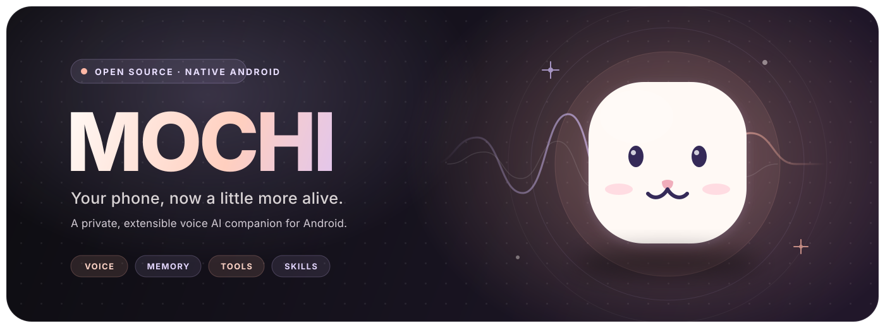

# Mochi · 老莫

**让 Android 手机成为你的 AI 伙伴：聊天、安排日程、查资料、办事情，
使用你自己选择的模型。**

[**下载 APK**](https://github.com/gongpx20069/hi-mochi/releases/latest)
· [**观看介绍视频**](https://www.bilibili.com/video/BV1u6aB6GEDD/)
· [English](README.md) · [简体中文](README.zh-CN.md)

**Android 8.0+ · 自备模型 API Key · 无需注册 Mochi 账号**

---

给闲置手机一个桌面上的位置，也可以直接在日常使用的手机上打开老莫。
打字、长按输入框说话，或者在陪伴模式中叫一声 **“老莫老莫”**。
对话、日程和设置默认保存在本机，AI 请求使用你配置的模型服务。

[快速开始](#快速开始) · [老莫能做什么](#老莫能做什么) ·
[连接服务](#连接服务) · [可选扩展](#可选扩展) · [隐私与控制](#隐私与控制)

## 快速开始

1. **安装老莫。** 从 [GitHub Releases](https://github.com/gongpx20069/hi-mochi/releases/latest)
   下载 APK。大多数手机选 `arm64-v8a`，不确定时选 `universal`；
   老旧 ARM 设备选 `armeabi-v7a`，Intel 设备和模拟器选 `x86_64` 或 `x86`。
   各安装包功能相同。升级时使用相同签名渠道覆盖安装，无需先卸载。
2. **连接模型。** 进入**设置 > AI 连接 > 添加 AI 连接**，选择服务商，
   按内置引导注册并获取密钥，填写账号可用且支持工具调用的模型。
   需要模型服务的 API 使用权限；聊天产品的订阅不一定包含 API 额度。
3. **开始交流。** 在**对话**模式点击输入框打字，或长按说话；
   松开后文字进入草稿，点击发送才会提交。在**陪伴**模式授予麦克风权限，
   使用所选唤醒词开始交流。其他服务按需连接即可。

默认使用 Android 系统语音，开始使用不需要额外的语音 API Key 或扩展 APK。
识别服务和可用音色取决于手机。配置遇到问题时，可打开**设置 > 配置自检**，
检查模型连接和相关配置；其中会发送一次简短模型请求，可能消耗额度。

## 老莫能做什么

### 随手聊天，也可以放在桌面陪伴

**对话**与**陪伴**共享聊天历史。对话模式支持打字、长按转文字和回答静音；
陪伴模式显示老莫的表情，支持语音回答和连续聆听。打开全屏显示，
可以把手机当作展示老莫、日期和时间的桌面信息屏。

在**设置 > 语音与唤醒**中选择 **“老莫老莫”** 或 **“Hi Mochi”**。
唤醒仅在陪伴页面前台可见、屏幕解锁时工作，**不支持锁屏或后台唤醒**。
设置中还可以切换中英文界面，编辑老莫的性格与交流偏好。

### 安排日常，也记得之前聊过什么

让老莫创建日程、管理带日期的待办、查看某天安排，或设置定时执行的 AI 任务。例如：

> “提醒我明天下午三点去赴约。”
>
> “每天早上帮我查一下这个主题，整理成摘要。”
>
> “我们上周讨论的旅行计划，最后是怎么定的？”

日程提醒与定时 AI 任务是两种能力：前者提醒你一件事，后者会调用模型执行任务，
并把结果保存到聊天中。顶部**任务**入口可以查看计划、执行结果和已连接扩展的任务。
通知权限与 Android 后台限制会影响提醒和任务的到达时间。

聊天历史保存在手机上。可选的**每日小记**和**回忆检索**帮助查找过去的重要信息
及原始消息，默认关闭；用于回答的相关历史片段可能发送给你选择的模型。

### 帮你查资料，也能自己浏览网页

让老莫阅读链接、比较商品、研究出行方案或整理公开信息。
智能体浏览器可以复用本机的网站登录状态，需要登录或验证码时请你接手。

想自己浏览时，点击对话或陪伴顶部的**浏览**，也可以从
**工具 > 智能体浏览器 > 网站与登录管理**进入。这里可以搜索、输入网址和管理网站账号。
浏览器提供后退、前进、首页和网站按钮；回到浏览器首页后可通过**返回网页**
继续查看原页面，**关闭**则结束本次手动浏览。

密码在本机加密保存，不发送给模型。短信账号只保存网站与手机号，不保存验证码。
请在网页或原生账号弹窗中填写凭据，不要把它们发到聊天中。
在对话中让老莫研究网页，不会自动切换到供你操作的浏览器页面。

### 一起写文档，也能操作手机应用

连接 **Notion、腾讯文档或飞书**后，老莫可以查找你的资料、整理研究结果、
共同起草文档，并写回已授权的工作区。连接**高德**后，可以查询路线、天气和附近商家。

在**应用操作**中选择允许老莫操作的应用，并手动开启 Android 无障碍辅助。
**媒体控制**可以在支持的播放器中点歌、控制播放和调节媒体音量。
播放器访问是可选授权，需要 Android 通知使用权，但老莫不会读取消息通知。
具体应用的兼容性不同，敏感步骤仍可能需要你亲自完成。

### 按需要添加技能

**工具（Tools）**是老莫可以调用的能力，**技能（Skills）**指导它如何使用这些能力。
只开启你需要的部分；启用技能不会自动开启依赖的工具，技能页面会提示缺少的配置。

| 内置技能 | 能帮你做什么 | 所需配置 |
| --- | --- | --- |
| 回忆检索（Memory Recall） | 结合每日小记和原始消息查找过去的对话 | 开启每日小记 |
| Mochi Planner | 管理日程和带日期的待办 | 无需额外服务 |
| Voice Navigation | 打开相关的老莫页面 | 无需额外服务 |
| Scheduled Automations | 执行一次性或周期 AI 任务 | 通知权限；精确闹钟权限可选 |
| 网页浏览（Browser） | 阅读链接、比较网页、搜索 Bing 或微信来源 | 开启智能体浏览器工具 |
| 应用助手（App Assistant） | 操作允许的应用并检查结果 | 应用操作与无障碍权限 |
| Product Search | 比较公开商品信息，不下单、不支付 | 浏览器工具 |
| Douban Ratings | 查询电影、图书评分与评论主题 | 浏览器工具 |
| US Stock Analysis | 根据公开行情和公司资料研究美股七姐妹 | 浏览器工具；不构成投资建议 |
| Notion Knowledge | 查找、起草和更新工作区页面 | 连接 Notion |
| 腾讯文档 Knowledge | 查找、起草和更新文档 | 连接腾讯文档 |
| 飞书知识（Feishu Knowledge） | 搜索、读取、创建和更新云文档 | 连接飞书 |
| 出行规划 | 路线、天气及火车票、机票信息研究，不预订 | 高德与浏览器 |
| 商家发现 | 查找附近商家并比较可用信息 | 高德 |

还可以在内置的 **skills.sh 技能市场**中发现和安装社区技能。
在**工具 > 添加工具**中，可以连接 MCP 服务，或为自己的公网 HTTPS JSON REST API
配置工具，无需编写扩展。REST API 预览不联网，测试会发送真实请求，
可能修改数据或消耗额度；写入操作需要确认。

## 连接服务

### 选择 AI 模型服务

老莫支持保存多个命名模型连接，点击**使用**切换；切换会取消正在运行的本地
Agent 任务。API 费用、额度、模型与区域可用性以服务商账号为准。

| 服务商 | 开始配置 |
| --- | --- |
| OpenAI | [API Key](https://platform.openai.com/api-keys) |
| Azure OpenAI | [Azure 资源](https://portal.azure.com/#create/Microsoft.CognitiveServicesOpenAI)，模型填写部署名称 |
| Groq | [控制台与 API Key](https://console.groq.com/keys) · [工具调用模型](https://console.groq.com/docs/models) · [账号限制](https://console.groq.com/settings/limits) |
| 魔搭 ModelScope | [注册](https://modelscope.cn/) · [Access Token](https://modelscope.cn/my/myaccesstoken) · [模型](https://modelscope.cn/models) · [每日魔粒](https://modelscope.cn/magicube/usage?tab=earn) |
| DeepSeek | [API 指南](https://api-docs.deepseek.com/) |
| Kimi | [API Key 指南](https://platform.kimi.com/docs/get-api-key) |
| GLM | [API 指南](https://docs.bigmodel.cn/cn/guide/develop/openai/introduction) |
| MiniMax（国内） | [API 指南](https://platform.minimax.cn/docs/api-reference/text-openai-api) |
| Agnes-AI | [API 与模型指南](https://wiki.agnes-ai.com/en/docs/overview) |
| 其他 OpenAI 兼容服务 | 填写服务商提供的 HTTPS 地址、API Key 和支持工具调用的模型 |

官方预设会填写服务地址，并提供配置链接。在高级设置中选择模型支持的
Responses 或 Chat Completions 协议；仅为支持图片的模型开启图片输入。

**魔搭配置提示：**验证邮箱，并
[绑定已实名认证的阿里云账号](https://www.modelscope.cn/docs/accounts/aliyun-binding-and-authorization)。
填写的是**魔搭 Access Token**，不是阿里云 AccessKey 或百炼 DashScope Key；
API-Inference 模型 ID 需包含组织名前缀。每日魔粒在魔搭平台领取，
老莫不代领，也不保证免费使用。Groq 的免费额度同样以账号限制为准。

### 可选的语音与其他服务

| 服务 | 配置入口 |
| --- | --- |
| Android 系统语音 | 默认使用，取决于设备已安装的识别服务与音色 |
| 讯飞 | [实时语音听写](https://www.xfyun.cn/services/voicedictation)提供 App ID、API Key、API Secret；在[控制台](https://console.xfyun.cn/)管理合成权限 |
| Azure Speech | [语音资源](https://portal.azure.com/#create/Microsoft.CognitiveServicesSpeechServices)提供地址和 API Key |
| 高德 | [Web 服务 Key](https://console.amap.com/)，不是 Android SDK Key |
| Notion | 从工具页进行 [MCP OAuth 授权](https://www.notion.com/help/notion-mcp) |
| 腾讯文档 | [MCP Token](https://docs.qq.com/open/auth/mcp.html) |
| 飞书 | 工具 > 飞书 MCP 引导完成[自建应用配置](https://open.feishu.cn/app)与用户授权，无需部署回调服务器 |

云端语音不是必需项。在**设置 > 语音与唤醒**中可选择识别服务，
并按需开启同一服务的回答播报；音色试听与云端语音可能消耗服务额度。
飞书目前支持云文档，不包含原生电子表格、多维表格与幻灯片。

## 可选扩展

主应用已包含对话、语音、日程和浏览器。只有需要下列额外能力时才安装扩展，
然后连接并开启相应的工具与技能。

| 集成／内置技能 | 附加能力 | 安装入口 |
| --- | --- | --- |
| 米家智能家居（Mi Home Smart Home） | 控制选定设备、执行手动场景、查看最新摄像头事件图片 | [Mochi Releases](https://github.com/gongpx20069/hi-mochi/releases)：`Mochi-Mijia-Extension` |
| AgentLink | 向已授权电脑工作区发送编程任务，继续共享聊天 | [AgentLink 应用与电脑端 Bridge](https://github.com/gongpx20069/android-agent-link) · [APK](https://github.com/gongpx20069/android-agent-link/releases) |
| Termux | 执行本机 Shell 命令，查看任务与输出 | [Mochi Releases](https://github.com/gongpx20069/hi-mochi/releases)：`Mochi-Termux-Extension`，另需 [Termux](https://github.com/termux/termux-app#installation) |
| WebDAV 文件（预览） | 在授权目录中查找文件名、读写文本与传输文件 | [Mochi Releases](https://github.com/gongpx20069/hi-mochi/releases)：匹配版本的 `Mochi-WebDAV-Extension` |

Mochi 扩展需使用匹配版本、相同签名的安装包，按工具页向导连接。
这些扩展技能默认关闭。

- **米家：**非官方连接器，支持的操作取决于设备。摄像头图片是云端事件，
  不是实时视频；连接时通过米家扫码授权。
- **AgentLink：**需要 Android 应用与电脑端 Bridge，并授权希望共享的工作区。
  关闭老莫后远端任务仍可继续，后台结果接收受 Android 调度限制。
- **Termux：**这是 Termux 权限下的完整 Shell，不是沙箱。连接并启用后，
  前台对话、定时任务和子 Agent 都可执行已开启的命令，无需逐条审批。
  输出可能提供给模型；关闭老莫或停止父 Agent 不会停止已提交的命令。
- **WebDAV：**填写 HTTPS WebDAV 地址、授权目录与应用密码。
  坚果云地址为 `https://dav.jianguoyun.com/dav/`。写入、管理、传输和局域网／VPN
  访问需要分别启用。文本上限 32 KiB，二进制文件上限 32 MiB；
  修改已有文件需要服务端提供强 ETag。这不是同步工具，服务和设备兼容性可能不同。

## 隐私与控制

**本地优先，不等于完全离线。** 设置、人格、历史、记忆、日程和凭据默认留在设备上。
模型请求会向你选择的服务发送必要的对话上下文和工具结果；云端语音及外部服务
也会处理完成任务所需的信息。开启并使用相关能力时，应用界面文字、
位置或文档内容可能提供给模型。

凭据使用 Android Keystore 支持的安全存储。**分享与导入**可以传递选中的连接，
但完整分享链接包含使用其 API 凭据的权限，**只发给可信的人**。
它不会分享聊天历史、记忆或 Android 系统权限。

连接、允许操作的应用和权限由你控制。已启用的浏览器操作和 Termux 命令可以
不经逐次审批执行，请谨慎选择。停止 Agent 不会撤销已经完成的修改，
也不一定会停止已交给扩展或远程服务的工作。

老莫仍在持续开发，语音效果、应用兼容性、提醒时间和后台运行受设备及 Android
限制影响。建议保持 System WebView 和语音服务更新，不要将关键提醒完全依赖于老莫。

## 帮助与贡献

[反馈问题或申请支持服务商](https://github.com/gongpx20069/hi-mochi/issues)
· [文档](docs/README.md)
· [从源码构建](docs/DEVELOPMENT.md)
· [贡献指南](CONTRIBUTING.md)

各版本的变化请查看 [GitHub Releases](https://github.com/gongpx20069/hi-mochi/releases)。

## License

[MIT](LICENSE)
