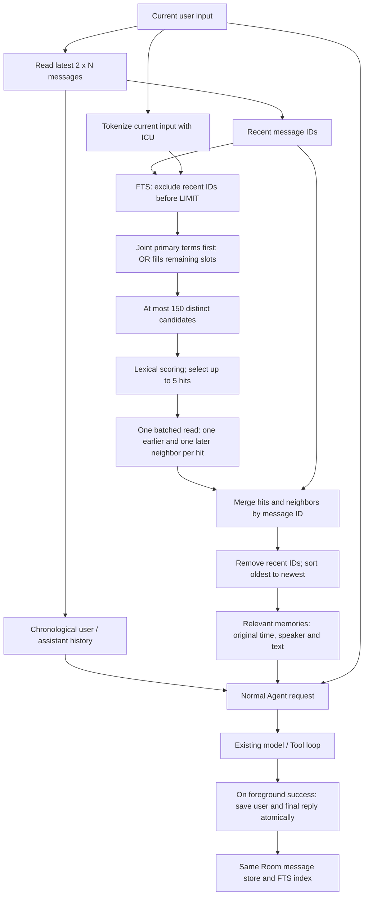
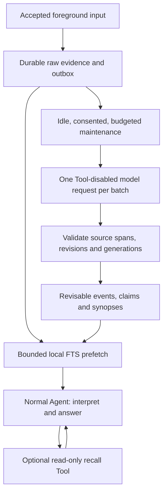

# Memory design

Updated: 2026-11-07.

This is the single owner of conversation-memory behavior, retrieval algorithms,
memory-specific diagnostics and measured results, and the future event-based
design. Other documents link here rather than repeating these contracts.
Product, interaction, Tool permission and general architecture authority still
follow [the documentation ownership rules](../README.md#authority).

| Part | Status |
| --- | --- |
| [1. Current design](#1-current-design) | Implemented; runtime baseline `aa92ae5` |
| [2. Device measurements and diagnostics](#2-device-measurements-and-diagnostics) | Physical-device results from 2026-11-06; diagnostic source `77ff1c4` |
| [3. Near-term optimization goals](#3-near-term-optimization-goals) | Identified work, not yet implemented |
| [4. Future event-based memory](#4-future-event-based-memory) | Proposed direction; not implemented or approved for rollout |

Measured values, current limits and future targets are different things.
In particular, the future payload budgets and recall Tool are not current
runtime behavior, and reorganizing this document does not authorize rollout.

## 1. Current design

### 1.1 Ownership and persistence

There is one chronological conversation store, not separate short-term and
long-term databases. Recent history and recalled history are two read strategies
over the same Room records. There are no event/claim tables, embeddings,
automatic organizers or dedicated memory Tools in the current implementation.

| Source | Responsibility |
| --- | --- |
| [AgentMemoryRepository.kt](../../android/app/src/main/java/com/example/mochi_pet/core/memory/AgentMemoryRepository.kt) | `loadContext`, successful-turn persistence and recalled-line formatting |
| [AgentMemoryDao.kt](../../android/app/src/main/java/com/example/mochi_pet/core/database/dao/AgentMemoryDao.kt) | Recent reads, bounded FTS candidates and batched neighbors |
| [MemoryLexicalSearch.kt](../../android/app/src/main/java/com/example/mochi_pet/core/memory/MemoryLexicalSearch.kt) | ICU tokenization, FTS query construction and lexical ranking |
| [MochiDatabase.kt](../../android/app/src/main/java/com/example/mochi_pet/core/database/MochiDatabase.kt) | Schema version 5 and migrations, including the FTS index |
| [AgentOrchestrator.kt](../../android/app/src/main/java/com/example/mochi_pet/core/agent/AgentOrchestrator.kt) | Recent message roles, recalled system context and normal Agent execution |
| [MochiHomeViewModel.kt](../../android/app/src/main/java/com/example/mochi_pet/feature/home/MochiHomeViewModel.kt) | Foreground recall/save flow and chronological history display |
| [MochiApplication.kt](../../android/app/src/main/java/com/example/mochi_pet/MochiApplication.kt) | Scheduled Agents use the same repository, including failure descriptions |

`AgentMemoryRepository` owns conversation persistence and recall; DataStore owns
the recent-turn setting. The default is 20 turns, configurable from 1 to 50.
The current reader loads the latest `2 * N` messages and reverses them into
chronological order. The UI renders each stored timestamp beside its sender.
Settings are independent of Provider configuration.

Stored messages already have IDs, `turn_id`, role, content, pre-tokenized
`search_text`, and an original timestamp. `saveTurn` trims both strings, skips an
empty pair, assigns a shared turn ID, and writes both messages and their FTS rows
in one transaction. It keeps the existing 20,000-character cap per stored
message. This is not a new runtime excerpt budget, and text beyond that existing
cap cannot be recovered by recall.

Foreground persistence currently saves successful user/final-assistant pairs;
failed foreground completion does not durably capture the accepted input.
Intermediate Tool traces remain run-local. Scheduled callers share the store,
so foreground-only successful-pair behavior must not be generalized to every
caller. History display currently reuses `loadContext` with an empty query.

### 1.2 End-to-end flow



The three request components remain distinct: recent messages retain their
`user`/`assistant` roles, older evidence is in `Relevant memories`, and the
current user request is appended once. Excluding recent IDs from recall does
not remove those messages from the model request; they are already in history.
No extra model request precedes normal answering.

### 1.3 Candidate selection

1. Tokenize only the current query. Split mixed Latin/Han runs, normalize case,
   use Android ICU word boundaries, retain numeric runs, and add Han bigrams
   and unigrams as lexical fallbacks.
2. Prefer lookup terms of at least two code points; use single-code-point
   terms only when no specific terms exist. Index text has at most 256 terms;
   a search uses at most 16 terms.
3. If multiple primary lookup terms exist, first search for their conjunction.
   Generated Han fallback fragments are not extra conjunction requirements.
   Use quoted terms separated by spaces: explicit `AND` is not portable to
   FTS4 builds without enhanced query syntax.
4. Exclude the recent IDs in SQL **before** ordering and limiting candidates.
   Within this preferred tier, take the newest matches.
5. If fewer than 150 candidates were found, run the broad OR query for the
   remaining slots, excluding both recent IDs and already selected IDs.
   A full preferred pool skips OR; a single-term query needs only OR.

The search can reach the entire eligible older history. It does **not** first
take the newest 150 old messages and then search only that slice. Dates order
matches inside each tier; there is no natural-language date-range planner.
The candidate cap bounds returned rows, not all rows SQLite might visit or sort.
An older relevant record can still fall outside a full tier's cap.

### 1.4 Lexical relevance

Ranking is deterministic lexical scoring, not an LLM judgment, embedding
similarity, or a probability of belonging to the same event.

```text
score =
  sum(matched term weight * inverse candidate frequency)
  + 2.0 * weighted query coverage
  + 1.5 if the normalized full query phrase occurs
  + a recency bonus in [0, 0.1]

inverse candidate frequency(t) =
  ln((candidate count + 1) / (candidates containing t + 1)) + 1
```

A Han unigram weighs 0.25; another single-code-point term weighs 0.6.
Longer terms weigh `1 + 0.1 * min(length - 2, 4)`. Phrase comparison removes
non-letter/digit characters and normalizes case. Frequency is measured inside
the current candidate set, not over the full database.

Ranking reads the already persisted lexical terms instead of re-running ICU
segmentation for every candidate, retains only query-relevant terms in its
working sets, and computes shared term weights once per query. Migration 4-to-5
rebuilt existing search text with the same tokenizer; message/index consistency
is required for this reuse.

### 1.5 Expansion, deduplication and presentation

Select at most five messages by relevance. A single DAO query uses the timestamp
index to read at most one earlier and one later neighbor for each hit. This is
one **message** per side, not one complete turn, and no additional turn completion
is performed. The windows contain at most 15 messages before deduplication.

Merge by message ID, covering overlapping windows and neighbors that are already
hits. Remove recent IDs again because expansion can cross the recent-window
boundary. Do not deduplicate by text: the same words at different times can be
distinct evidence. Finally sort all recalled messages by original time,
oldest to newest, **not by relevance score**.

The recalled section declares the device timezone once as `NOTE:<timezone ID>`.
Each line retains its original instant rendered with the UTC offset, speaker
(`User` or `Mochi`) and stored text. Recent messages retain role information but
do not receive this per-message timestamp prefix in the model request.
No matches means no unrelated recency filler.

For a populated query the repository needs at most four DAO reads: recent
history, preferred candidates, optional OR candidates and optional neighbors.
This is not a bound on the underlying SQLite execution work or latency.

### 1.6 Current boundaries

- There is no unified byte/token cap over recent history and recall.
  Recent-turn, candidate and hit counts do not bound total model-input bytes.
- Recall does not add excerpt truncation, generated event conclusions,
  query-rewriting models, a `recall_memory` Tool or background model calls.
- Chronological neighbors can cross topics or split a question/answer pair.
  Short references and paraphrases remain weaknesses of lexical retrieval.
- Source roles/timestamps are not a complete provenance or freshness model.
  Scheduled text can affect foreground recency; derived corrections, deletion
  generations and event membership are not current features.

## 2. Device measurements and diagnostics

### 2.1 Method and scope

Measured on 2026-11-06 using runtime commit `aa92ae5` and the diagnostic in
commit `77ff1c4`. The ARM64 Debug APK kept version name `1.0.18` / code `10018`
for a same-signer in-place update. Its verified installed SHA-256 was
`6c188005a06b0064223e21b0e36b24685f7bfe242684e9b7e8c08a933b7d9e67`.

| Setting | Actual configuration |
| --- | --- |
| Device | Physical M2012K11AC (`alioth`), Android 13 / API 33, ARM64 |
| Backend | Production `RoomAgentMemoryRepository.loadContext`, Android SQLite/FTS4 |
| Data | Unique disk-backed synthetic database; 1,000, 10,000 or 100,000 messages, not turns |
| Text | Ten synthetic Chinese templates; mean 80.6 characters / 241.8 UTF-8 bytes per message |
| Context | Current limits from section 1; recent setting fixed at 20 turns |
| Sampling | Five warmups, then 50 serial requests per case; concurrency 1 |
| Included latency | Recent read, query preparation, candidate retrieval/ranking, neighbor read, deduplication and recalled-line assembly |
| Excluded latency | Fixture creation, cloud model calls, network, STT, TTS and end-to-end voice interaction |
| Power control | Controlled repeat had `interactive=true` before and after every case; connected to power, no power-setting changes |
| Data isolation | No real chat/configuration used by the test body; temporary database deleted in `finally` |

The four fixed queries are joint terms (`杭州 酒店`), a broadly matching word
(`安排`), an empty conjunction with OR fallback (`杭州 航班`), and no match
(`quasarxylophone`). They exercise retrieval mechanics, not open-domain recall
quality. Messages are not sampled from real user history.

P50 is the median-like nearest-rank sample; P95 is the 95th percentile.
For 50 samples, the implementation selects the 25th and 48th sorted values.
Serial requests/second is `50 / measured loop seconds`, approximately the inverse
of **mean** latency, not the inverse of P95. Its loop also includes result
checks and byte counting. No model tokens are generated, so tokens/second and
LLM-backend comparisons are not applicable.

### 2.2 Controlled interactive results

The final repeat used **100,000 messages** with interactive state recorded
before and after every case. All latency columns are milliseconds.

| Case | P50 | P95 | Maximum | Serial requests/s | Reopen-first |
| --- | ---: | ---: | ---: | ---: | ---: |
| Joint terms | 455.4 | 479.4 | 487.4 | 2.21 | 436.3 |
| Broad word | 1,051.7 | 1,060.4 | 1,070.0 | 0.96 | 979.6 |
| OR fallback | 527.5 | 543.6 | 554.0 | 1.92 | 485.7 |
| No match | 283.3 | 291.9 | 292.8 | 3.53 | 300.8 |

Reopen-first includes the first lookup after reopening Room. The fixture was
already written and Android's OS cache was not cleared: this is **not** a
process-cold, OS-cache-cold or device-reboot measurement.

Mean stage times from the same controlled run:

| Case | Recent read | FTS candidate reads | Neighbors | Other work |
| --- | ---: | ---: | ---: | ---: |
| Joint terms | 276.2 | 104.1 | 2.6 | 69.3 |
| Broad word | 276.7 | 693.0 | 2.4 | 68.4 |
| OR fallback | 277.9 | 169.2 | 2.4 | 72.4 |
| No match | 273.7 | 6.3 | 0.0 | 3.2 |

DAO times include dispatch and row mapping. Other work includes preparation,
ranking and output assembly; it is not a pure CPU-time measurement. These are
means, so they must not be added to reconstruct P95.

The entire instrumented process had 30 threads in the before/after samples,
approximately 125-149 MiB PSS and 5.8-28.7 MiB live Java heap. These are not
repository-only allocations, active-worker counts or instantaneous peaks.
Returned recent text plus recalled lines occupied 9,672-13,937 UTF-8 bytes;
this excludes the rest of the model request and is not a new enforced budget.

### 2.3 Preliminary scale check and power-state limitation

The first complete run did not record interactive state for each case.
Keep its scale results as reference, not as controlled foreground acceptance.
Cells below are P50 / P95 in milliseconds.

| Messages | Joint terms | Broad word | OR fallback | No match |
| ---: | ---: | ---: | ---: | ---: |
| 1,000 | 121.4 / 142.0 | 161.7 / 187.5 | 121.7 / 141.4 | 29.5 / 35.2 |
| 10,000 | 144.3 / 206.4 | 192.4 / 209.1 | 145.5 / 205.8 | 47.3 / 62.9 |
| 100,000 | 478.6 / 489.1 | 1,064.1 / 1,072.3 | 539.6 / 555.3 | 287.7 / 294.1 |

A subsequent stage-instrumented run ended with the phone asleep. At 100,000
messages its P95 rose to 2,531.6 / 7,004.8 / 3,036.4 / 1,788.4 ms for the same
four cases. Per-case interactive flags were not yet recorded, so that run
cannot establish foreground latency or isolate the causal effect of sleep.
It motivated the explicitly interactive repeat above; do not pool these runs.

### 2.4 Findings and limits

The physical-device recent-query plan was:

```text
SEARCH TABLE agent_memories USING INDEX index_agent_memories_type (type=?)
USE TEMP B-TREE FOR ORDER BY
```

Reading only the latest 40 messages still became expensive as history grew.
Even no-match recall pays that cost. Broad FTS was the other major measured
stage, whereas the batched neighbor read was small. A 150-row output limit
does not imply 150-row database work.

These results do not establish an optimal algorithm or low latency at large
history sizes. There was no old-version/device A/B baseline, release-build
comparison, true cold-start test, concurrent-writer test or end-to-end speech
measurement. Fewer calls and reused tokenization are implementation properties,
not proof of a particular percentage speedup.

### 2.5 Reproduce the diagnostic

Source:
[AgentMemoryLatencyTest.kt](../../android/app/src/androidTest/java/com/example/mochi_pet/core/memory/AgentMemoryLatencyTest.kt).
Deterministic retrieval regressions:
[AgentMemoryRepositoryTest.kt](../../android/app/src/test/java/com/example/mochi_pet/core/memory/AgentMemoryRepositoryTest.kt).
General SDK/JDK, build and verification setup remains in
[DEVELOPMENT.md](../DEVELOPMENT.md#build-and-verify).

From `android/`, using a matching signer and the device's ABI:

```powershell
.\gradlew.bat :app:assembleDebug :app:assembleDebugAndroidTest `
  "-PmochiVersionName=<installed-1.0.x-version>" --no-daemon
adb -s <serial> install -r app\build\outputs\apk\debug\app-arm64-v8a-debug.apk
adb -s <serial> install -r app\build\outputs\apk\androidTest\debug\app-debug-androidTest.apk
adb -s <serial> shell am instrument -w `
  -e class com.example.mochi_pet.core.memory.AgentMemoryLatencyTest `
  -e mochiMemoryLatency true `
  com.example.mochi_pet.test/androidx.test.runner.AndroidJUnitRunner
```

The default development version may be older than the installed app; preserve
the version code and signer rather than forcing a downgrade. Never uninstall
or clear user data. Add `-e mochiMemoryLatencyMessages 100000` to repeat one size;
the supported sizes are the three in the method table.

The opt-in test emits `MEMORY_LATENCY` JSON, uses no real history or model calls,
and cleans its unique synthetic database. Require `OK (1 test)` because an
instrumentation crash can still return shell exit code zero. Check interactive
flags and record power/thermal conditions. Do not change power settings without
authorization or describe sleeping-device results as foreground voice latency.

## 3. Near-term optimization goals

Keep the implemented FTS architecture before introducing a new memory system.
The following work is identified, **not implemented or a measured improvement**:

1. Remove the recent-query ordering bottleneck while preserving message
   eligibility and recent-window semantics. Compare query plans on device;
   any schema/index change requires migration, snapshot and migration coverage.
2. Reduce broad FTS selection/sort work while preserving joint-term priority,
   recent-ID exclusion and reachability across older history. Taking only a
   recent slice before matching is not an equivalent optimization.
3. Profile preparation, ranking and formatting separately before adding caches
   or complexity. Compare useful evidence and returned IDs, not latency alone.
4. Repeat controlled interactive, cold-start, long-text and concurrent-write
   measurements. Keep isolated component latency separate from first-audio time.

Do not add embeddings, model-based query routing, automatic event organization
or a hard 32 KiB context cap as a shortcut. A byte budget and its evidence
selection policy require a separate decision; reducing candidate count is not
a substitute for fixing database work. The event proposal below is a later
direction, not a prerequisite for these optimizations.

## 4. Future event-based memory

**Everything in this section is proposed, not implemented or approved for
rollout.** Its numerical limits are initial hypotheses, not current settings or
device results. The proposed 100-raw-candidate and 32 KiB payload
budgets must be evaluated against the current design and measurements rather
than silently replacing them.

### 4.1 Design direction

Keep one visible conversation. Organize its history into evidence-backed
events, maintain a small conversational focus, and retrieve relevant evidence
for each request. Do not route a request into an exclusive topic partition.

Use two paths:

- **Foreground:** durable input, bounded local recall, normal Agent execution,
  and optional read-only deeper recall. No mandatory model call before the
  normal Agent request.
- **Maintenance:** one bounded, Tool-disabled model request for a batch of
  messages, followed by validated transactional changes. Maintenance must not
  be a prerequisite for answering the next message.

V1 uses existing Room/FTS4 and the selected chat Provider. It does not require
an embedding service, a downloaded language model, Python, a graph database,
another account, or an always-running background process. This is lexical
retrieval over semantically organized material, **not dense semantic search**.
Paraphrase recall is a release gate; if it fails, revise the design or add a
separately measured multilingual embedding adapter rather than relabeling FTS.



#### Intended experience

- Continue a discussion after a brief interruption or a long absence.
- Interpret referential input using its actual context, not the last label.
- Handle one message about several things.
- Distinguish a correction from compatible additional information.
- Use no old memory when it is unnecessary.
- Clarify genuine ambiguity rather than confidently recalling the wrong object.

#### Non-goals

No conversation folders, automatic task resumption, autonomous memory-driven
actions, full knowledge graph, deep summary tree, inferred personality profile,
or prediction-based collection of personal information. An event is not a
Planner calendar event, Agent runtime, execution queue, or permission scope.

### 4.2 Invariants

1. Original accepted messages are the evidence source, not guaranteed truth.
   Model summaries and inferred relations are revisable projections.
2. Every derived statement has valid source references. Assistant suggestions
   are not user decisions; historical Tool observations are not live state.
3. A message may support several events. An event may contain non-adjacent
   messages. The visible conversation remains chronological.
4. New accepted input is readable before background consolidation. No stale
   projection may be presented as known-current without its update coverage.
5. Foreground focus changes only in response to the current foreground
   interaction. A schedule or maintenance job cannot seize that focus.
6. Memory never grants permission, supplies a fresh write guard, or resumes
   a task. Existing typed Tools and their source-of-truth repositories do that.
7. Cancellation, deletion and configuration changes invalidate late work.
   Retrying maintenance is idempotent and cannot recreate deleted sources.
8. Recall failure, partial coverage and maintenance failure are explicit
   states, not successful empty results.

### 4.3 Storage and ownership

Names below are proposed domain concepts; final Room naming belongs to the
implementation. Domain interfaces return immutable models, not Room entities.

| Record | Required information | Ownership |
| --- | --- | --- |
| Message/turn | Stable IDs, text, role, provenance, accepted sequence, observed time, reply status and truncation metadata | Conversation repository |
| Event | ID, descriptive title, evidence-backed synopsis, discussion state, revision and projection coverage | Memory repository |
| Event evidence | Event ID, message ID, validated source span and membership revision | Memory repository |
| Claim | Scope/object, property, value/text, evidence references, validity state, applicable time and supersession links | Memory repository |
| Focus | Foreground generation, reference candidates, focused/interrupted event IDs and source sequence | Focus reducer |
| Maintenance job | Source range, schema version, attempt state, lease, retry time and configuration/deletion generation | Room outbox/coordinator |

#### Messages

Evolve the existing table rather than copying chat history into another store.
Allocate a monotonically increasing database sequence transactionally; wall
clock timestamps remain for display and temporal reasoning, not concurrency.
Keep occurrence time separate from receipt time when the source specifies it.

Provenance distinguishes foreground user, foreground assistant, scheduled
input/output, explicitly permitted observation, and legacy unknown. A text
prefix must never establish provenance. Existing imported/history rows cannot
be promoted to confirmed user preferences merely because `role == user`.

Record accepted user input before network work. Assistant completion,
interruption and failure have distinct states. The current request must not
appear twice, once in history and again as the new user message. Failed Tool
rounds and partial STT hypotheses are not successful conversation turns.

Retain existing input bounds until deliberately revised. A stored truncated
answer must be marked as truncated; "raw evidence" does not promise text that
was never stored. No camera bytes, raw command output, credentials, or hidden
model reasoning are eligible memory sources. Do not ingest Provider settings,
raw Tool payloads or other private stores. Redact known credential values
before indexing/organization; a heuristic detector is not a guarantee that
arbitrary user-pasted secrets can be recognized. A user must be able to exclude
or delete a message before permitting historical organization.

#### Events and claims

An event describes a concrete discussion or experience, such as selecting
commuting headphones, not a broad category such as technology. Discussion
state can be open, resolved or archived; none means an external task finished.
Archiving changes retrieval priority, not evidence retention.

Each source span uses offsets into the stored immutable text, with a documented
Kotlin-compatible offset convention and range validation. A sentence about two
objects can have separate evidence spans. An ambiguous referent stays unresolved.

Claims carry explicit scope. Default to their event/object; global scope needs
explicit supporting user language or a native user edit. First-version
maintenance does not infer sensitive traits or generalized personal preferences.
Claims can be proposed, supported, disputed, superseded or retracted. A model's
self-reported confidence is not an authorization or a calibrated probability.

A synopsis is a derived overview, not an independent list of current facts.
It records exact dependency IDs/revisions. Membership corrections and claim
updates invalidate affected synopsis sections; never let stale summary prose
reintroduce a superseded requirement.

#### Focus

Keep at most one primary and two interrupted/reference candidates initially.
These are small hints backed by messages, not hard routing gates. Unlinked
recent messages can be reference candidates before events have been organized.
After restart, reconstruct from recent foreground input; old focus is a hint,
not a command to continue an action. Short-term focus decay does not delete
long-term events.

Use one pure reducer and sequence guards. Maintenance may attach an event ID
to a hint but cannot move focus backwards or change it because a scheduled
result arrived.

At input acceptance, the reducer adds a raw reference hint without pretending
to know its event. To obtain a semantic focus decision without another model
round, extend the normal final response with optional bounded `memory_focus`
metadata: mode (`retain`, `replace`, `mixed`, `unresolved`) and up to three
event/source handles issued in that request. No generated descriptions or
unrestricted IDs are accepted. Apply it only after a valid final reply and
only if the foreground generation still matches. It is not a fact mutation.

Missing metadata leaves raw hints available and does not force a switch.
Invalid metadata produces a diagnostic and is ignored independently of an
otherwise valid answer. This requires a tolerant optional-field boundary
around the strict answer contract, with dedicated malformed-field tests.
Its small output overhead still contributes to non-streaming speech latency.

### 4.4 Foreground read path

#### Capture and consistent snapshot

Accept final text, commit it and its outbox work, then read a bounded snapshot.
The snapshot includes the source sequence and relevant event revisions.
Never hold a Room transaction or maintenance lock during a network request.
The history display API is separate and cannot invoke a model or maintenance.

If input persistence fails, display a typed memory error. The current request
may continue explicitly in non-durable mode using its in-memory text, but must
not say it was remembered. Never execute or enqueue the input twice on retry.

For a database read failure or local recall deadline overrun, return typed
unavailable/partial coverage, cancel outstanding read work, and continue with
current in-memory context only when it is sufficient. If the answer depends
on inaccessible history, explain the limitation rather than guessing. A
performance target is not permission to silently discard necessary evidence.

#### Local prefetch

Search raw messages plus event titles, supported keywords and synopses using
the existing ICU tokenizer and FTS4. Query text itself has priority. A short
reference may add a separate contextual query from recent focus; do not append
all recent conversation to every search and thereby force the old topic.

Union bounded candidates from:

- lexical event and raw-evidence matches;
- relevant foreground focus/reference hints;
- pending raw messages and effective claims for matched objects.

Use source eligibility, exact object matches, query coverage and a small
recency preference. Recency must not override a clearly stronger match.
No score threshold is called "semantic certainty." Handle strong competing
objects as ambiguity, not a tie broken by newest timestamp.

Replace arbitrary chronological-neighbor expansion with event evidence.
For unorganized legacy messages, a source-labelled bounded raw excerpt is
allowed, but cannot be described as a verified event boundary.

#### Main-model interpretation and optional deeper recall

The normal Agent request receives current text, bounded recent messages,
focus hints and a small evidence pack. The main model performs semantic
interpretation as part of answering; there is no preceding router LLM.

Propose a native read-only `recall_memory` Tool with two actions:

- `search`: bounded query, optional date/object constraints, returns event
  candidates, provenance and coverage; the model can rephrase its query.
- `read`: candidate event or source IDs from this run, expected revisions and
  an opaque bounded continuation, returns evidence excerpts and claim states.

Arguments and result envelopes follow `AGENT_TOOLS.md`. IDs and continuations
are validated; no arbitrary SQL or filesystem access. V1 permits at most two
calls total per foreground run, also charged to the existing Tool-round limit.
There are no write, merge or delete actions. A changed/deleted source returns
an explicit conflict/not-found result rather than serving stale cached text.

Only the foreground Main Agent receives this Tool in V1. Scheduled Agents
use the shared bounded repository read path without foreground focus; children
retain existing isolation and receive only explicitly selected parent context.
Automatic maintenance has no Tool registry.

Adding the Tool requires normal catalog/registry controls. Disabled recall
must not be bypassed through Browser, JavaScript or another provider. Separate
the recall switch from maintenance consent, and disclose their consequences.

#### Context packing

Carry typed evidence until final serialization. Mark source role, original
time, validity, covered-through revision and omissions. Memory is untrusted
historical data, subordinate to current instructions and actual Tool evidence.

Preserve a short continuous foreground tail to avoid severing references.
Then include relevant facts, event backgrounds and supporting excerpts.
Deduplicate against recent history. Do not include every active event.
Do not splice non-adjacent excerpts into a fabricated user/assistant exchange.

The existing recent-turn setting remains an upper bound. UI history is not
truncated to the model's budget. If evidence is cut, do so at valid text
boundaries, label the omission and provide a read handle. Never silently cut
JSON or a claim's provenance fields.

### 4.5 Freshness and correction protocol

Asynchronous organization means "current" cannot be a boolean on an old
summary. Track source processing coverage and outstanding gaps, not just the
largest processed sequence. A source can be incorporated, classified as having
no durable update, unresolved, pending, or blocked by an error. Completing a
worker attempt is not the same as resolving an ambiguous source. A question
with no update need not block freshness forever; an unresolved possible
correction cannot be hidden under a successful "unassigned" result.

For each request, combine covered projections with unprocessed recent input.
The latest explicit user instruction takes precedence over older derived
statements about the same object. This is **read-your-input**, not a claim
that every correction is synchronously understood and materialized.
The read envelope distinguishes projected sources, raw deltas actually visible
to the answering model, and omitted/unresolved sources. Current input is already
visible as the query; do not duplicate it or invent a gap merely because its
maintenance job has not run.

If unprocessed input cannot fit the context budget:

1. Include the latest contiguous foreground tail and a coverage-gap marker.
2. Retrieve pending raw evidence matching the current object/query.
3. Treat potentially affected old projections as historical, not verified
   current. For an exact current-state answer, use deeper recall or clarify.
4. Never hide a gap and answer "your current preference is ..." from an old
   synopsis alone. If the two-call budget is insufficient, say so.

Unclassified pending messages may affect an unknown event. Until scope is
resolved, the gap applies to claims of global freshness; it cannot safely be
declared irrelevant just because lexical retrieval returned no match.

Within maintenance, operations are explicit:

- ADD: independent new statement.
- SUPPLEMENT: compatible detail; keep both sources.
- SUPERSEDE: same resolved object/property and incompatible newer requirement
  with adequate source support.
- DISPUTE: conflicting evidence without a justified ordering.
- RETRACT: explicit removal of applicability.

Record both applicable time and observed time. "I used to prefer X" is not a
new instruction to replace Y. Suggestions, quotations and hypothetical
examples do not count as user commitments.

Immediately reject syntactically invalid changes, nonexistent IDs, out-of-range
evidence and stale revisions. Semantic correctness still needs evaluation;
JSON validation alone cannot establish that a quoted sentence supports a claim.

### 4.6 Maintenance algorithm and bounded scheduling

#### One batch, one model request

The coordinator leases a bounded pending batch and snapshots candidate event
revisions. FTS finds possible existing events. A Tool-disabled request to the
currently enabled chat Provider proposes an atomic typed patch containing:
event creation/attachment, evidence spans, claim operations and bounded synopsis
changes. It must account for every input item, including explicit "unassigned."

Model-local temporary IDs may name new records; the application allocates final
IDs. The response has no executable instructions, Tool calls, navigation or
direct database operations. Use a dedicated strict response DTO over the
existing Provider client, not the user-facing final reply parser.

Validate the patch, then transactionally compare source/deletion generations
and event revisions, commit changes and indexes, and advance item coverage.
Never use last-writer-wins to resolve a stale maintenance response. On conflict,
discard the patch and retry later against fresh candidates within the budget.

Do not automatically merge entire events merely because their titles match.
V1 can add supported membership or a related-event reference; bulk merge/split
requires an explicit, independently validated reorganization operation and is
deferred. Duplicate candidate events are safer than irreversible conflation.
Retrieval can present both with their distinct evidence.

#### Scheduling policy

Initial proposed policy, adjustable only after measurements:

| Control | Initial value/behavior |
| --- | --- |
| Batch | Up to 6 completed turns or 16 KiB of source UTF-8 text, whichever is smaller |
| Ordinary trigger | At least 4 pending completed turns and 30 seconds of foreground inactivity |
| Sparse conversation | A smaller batch after 5 minutes of inactivity, best effort |
| Concurrency | One maintenance request; none during listening, foreground Agent work or speech playback |
| Deadline | Lesser of the configured Provider timeout and 45 seconds |
| Automatic budget | 20 attempts per rolling 24 hours, including repairs, retries and canceled requests that started |
| Retry | At most one automatic retry for transient/invalid-output failure per batch, delayed with backoff |
| Backfill | Explicit user action, resumable, shares the budget; no upgrade-time bulk upload |

Batch selection may include an accepted user turn whose reply terminated in
failure/cancellation. An in-flight turn waits until it terminates or restart
reconciliation marks it interrupted. Oversized single messages are handled as
bounded, source-addressed slices; processing a slice never marks the whole
message incorporated. A context-only overlap is not new input or new evidence.

Foreground activity preempts maintenance without waiting for the remote server
to stop. Cancel locally, reject late responses and keep the job resumable.
Rate limits or already consumed provider quota cannot be undone by cancellation.
Use a cooldown/backoff after preemption; do not repeatedly restart the same job
between closely spaced utterances.

An in-process debounce is an optimization. A Room outbox plus unique one-time
WorkManager work provides best-effort recovery. Recheck activity, network,
battery/thermal constraints, consent and budgets at execution time. Do not use
exact alarms, periodic polling, a permanent foreground service or wakelocks
to guarantee the five-minute target. Doze/OEM restrictions can delay work.

Provider/auth/schema failures pause the affected queue with a visible status
and repair action. Budget exhaustion leaves records searchable as raw history.
No maintenance means reduced organization, not loss of original messages.

### 4.7 Latency, memory and cost feasibility

#### Critical path

```text
ordinary:
  accepted input -> local commit/recall -> existing Agent completion -> TTS

deeper recall:
  accepted input -> local commit/recall -> Agent Tool request
  -> local memory Tool -> Agent continuation [possibly another recall] -> TTS

maintenance:
  idle + eligible budget -> bounded Provider request -> local transaction
```

The current client returns a complete structured answer before speech.
This proposal does not introduce streaming or promise a time-to-first-token
improvement. More memory can also slow the normal model request even with zero
extra calls; measure prompt growth and end-to-end speech latency.

Approximate additional time:

```text
ordinary delta = local durable write + local recall
                 + provider latency change from the changed prompt
deep delta = ordinary delta + additional provider rounds + local Tool work
```

Do not describe a local Tool taking 50 ms as a 50 ms deep-recall experience.
TiMem's reported recall P50 of 1.76-2.35 seconds, under its own experiment
configuration, illustrates model-call overhead, not an Android prediction.

#### Initial budgets and targets

These are proposed limits/acceptance criteria. They require representative
Android device measurements before rollout.

| Item | Limit or target |
| --- | --- |
| Mandatory extra model requests before normal answering | 0 |
| Local commit + prefetch + packing | Warm P50 <= 50 ms, P95 <= 150 ms; cold P95 <= 400 ms |
| Foreground raw candidates | At most 100; bounded excerpts, not 100 unbounded documents |
| Event candidates / expanded events | At most 24 candidates / 3 expanded events |
| History + initial memory payload | At most 32 KiB UTF-8, excluding current query and existing persona/Tool policy |
| Payload allocation | Reserve up to 16 KiB for recent/pending evidence; remaining space for focus, facts and older evidence |
| Recall Tool | At most 2 calls, at most 8 KiB payload per call; bound cumulative memory payload to 48 KiB |
| Maintenance prompt | At most 32 KiB UTF-8 total, including source, candidates and instructions |
| Maintenance decoded patch | At most 8 KiB UTF-8; bounded response transport separately |
| Incremental local memory working set | Target <= 16 MiB P95 during recall; no resident embedding model |
| Ordinary voice latency regression | Target P95 <= 300 ms versus baseline at equal useful-evidence coverage |

Reserve does not mean padding or a requirement to retrieve old memory. Pack
less when sufficient. Limits do not reduce the accepted current-query limit.
When evidence cannot fit, use labelled excerpts/deeper recall rather than
silently asserting completeness.

Set a separate 64 KiB maintenance HTTP response cap, rather than inheriting
the general client's 2 MiB default. A proposed 500 ms local recall
deadline yields explicit partial/unavailable recall, not forced success.
Use cancellable IO and bounded SQL/decoding work so timeout does not leave
unbounded computation running. Quality and timing gates include this path.
The preceding durable write must have a reconciled outcome: use its stable
turn ID to resolve an interrupted/uncertain commit rather than blindly inserting
again. A recall deadline does not justify leaving a database write unowned.

UTF-8 byte limits are deterministic application bounds, not exact token
limits. Different Providers tokenize differently. The current DTO omits token
usage and output limits; instrumentation and optional compatible output-limit
support are explicit implementation work. Record actual usage when supplied,
otherwise mark it unavailable. Never label a character estimate as token usage.
Provider support for output limits must be capability-tested, not assumed from
an OpenAI-compatible URL. Capping response bytes limits local memory, not the
provider bill or server-side generation after cancellation.

For 60 short completed turns, batches of 4-6 imply roughly 10-15 successful
maintenance calls before retries or sparse-tail batches, not "free memory."
The 20-attempt ceiling bounds automatic requests, not monetary spend. Slow
Providers may repeatedly hit the deadline and must expose a paused/degraded
state instead of burning quota indefinitely.

Measure raw text bytes, index/database growth, Android PSS/RSS and CPU time.
Do not estimate battery improvement from fewer tokens. Maintain no active
maintenance wakeups when the queue is empty. Historical evidence is not silently
evicted to make a benchmark pass.

### 4.8 Privacy, cancellation and user controls

Event-memory maintenance is an explicit opt-in during rollout, with a short
disclosure: selected conversation excerpts are sent to the configured Provider
and consume its quota even outside an answer. Legacy local recall remains
available without maintenance. No silent Provider switch or automatic historical
backfill is permitted.

Expose a minimal Settings surface: mode/status, pending/failed work, pause,
explicit organize-history action, and inspection/correction/deletion of saved
event facts with source references. These are exceptional controls, not a
requirement to organize every conversation manually. No per-turn popups.

Recall and maintenance share a deletion generation but have separate consent
gates. Disabling maintenance cancels its calls; disabling recall removes the
Tool and all persisted-history injection for subsequent requests. When recall
is off, only up to two completed turns from the new in-memory foreground
exchange may accompany current input; clear previous recall/focus caches at
the switch and do not restore this tail after process death. Settings must
explain this distinction from deleting history. Turning a feature off does
not itself delete stored history or prevent its local chronological display.

A Provider configuration change cancels in-flight organization and invalidates
its response generation. New jobs resolve the current configuration at dispatch,
never a credential snapshot persisted in Room. Consent and attempt counters
must not reset as a side effect of key rotation or model switching.

Before displaying an in-flight reply or executing a subsequent Tool, check
interaction, recall-consent and deletion generations. Forgetting memory during
a run cancels the stale run; otherwise already assembled prompts could still
produce a deleted fact. Deleting local data cannot recall data already sent
to the Provider or change its retention policy.

Forget operations define their scope:

- Forgetting a fact excludes its supporting spans from both model recall and
  organization, while retaining display history only if the user chose to
  keep it. This differs from marking a requirement obsolete, which retains
  historical recall with an explicit superseded/retracted status.
- Forgetting an event deletes or excludes its exclusive evidence; shared source
  messages require span-aware exclusion or clear confirmation to delete the
  whole message. Raw FTS must not expose forgotten spans through another route.
- Deleting source messages invalidates all dependent claims, synopses, indexes,
  focus hints and pending jobs in the same logical operation.

Exclusion/tombstone metadata contains identifiers, not the forgotten text.
Derived summaries with mixed dependencies are removed or rebuilt solely from
eligible sources, never kept on the assumption that they probably omit it.
Clearing all memory must include these records and invalidate running workers.
The monotonic deletion generation itself survives clearing/importing data to
prevent an old worker from matching a reset generation.
This exclusion applies to identified historical evidence, not a promise to
recognize every semantic duplicate. Clearly disclose its scope; a user can
delete the broader event/history if needed. A new explicit user statement may
legitimately introduce the information again. An explicit import of an old
backup can also reintroduce text and must never be presented as preserving
deletions the backup did not contain.

Do not auto-write `USER.md` or other persona files. Preserve existing image,
Tool-output and secret exclusions. General backup is not added by this work:
when supported, exports must preserve provenance and exclusions, exclude
transient leases/focus/caches and secrets, and define restore/import eligibility.
Never restore a deleted projection from an old index or silently schedule an
upload of imported history.

### 4.9 Integration and migration

| Surface | Required change |
| --- | --- |
| `AgentMemoryRepository` | Separate display history, accepted-input recording, reply completion and evidence recall |
| `core/memory` | Pure focus reducer, context assembler, validated patch applier and maintenance coordinator |
| Room | Add message metadata, evidence/claim/event/outbox storage, constraints, indexes and schema migration |
| `AgentPromptBuilder` | One bounded typed memory serialization path with provenance, freshness and trust rules |
| `AgentOrchestrator` / factory | Register bounded foreground recall, validate optional focus metadata, invalidate stale reads and retain existing Tool limits |
| Home ViewModel | Save accepted input, finish reply state, display persistence/coverage errors without repeated popups |
| Scheduled execution | Explicit provenance, event-scoped reads, no foreground-focus changes and no preference promotion |
| Subagents | Preserve existing isolation; no new global-memory access |
| AgentLink/Planner/Termux | Keep execution state in existing owners; memory stores only allowed references/discussion |
| Provider adapter | Dedicated Tool-free organizer contract, cancellation/deadline controls and usage instrumentation |
| Settings | Consent, maintenance status and source-backed correction/forget controls |

Evolve the existing `AgentMemoryRepository` ownership rather than introducing
a second competing conversation store or repository.

Use the next schema version available at implementation time, with a checked-in
schema and migration coverage. Do not assume version 6 remains unclaimed.
Assign stable sequences to legacy rows in timestamp/ID order; preserve original
times and turn IDs. Mark uncertain provenance/turn pairing explicitly.

Migration is local and mechanical: no network, LLM calls, destructive reset or
full semantic reorganization. Existing FTS remains usable. Event backfill is
incremental and optional. Disabling event organization while recall remains
enabled permits raw lexical recall; disabling recall itself permits no persisted
history injection. A rollout rollback must respect both consent states, never
re-enable recall, downgrade the database or discard newly accepted messages.

Before implementing each behavioral change, update PRD, interaction, technical,
Tool and ownership contracts as applicable. This proposal alone does not
override current successful-turn persistence or registry contracts.

### 4.10 Evaluation and release gates

Use synthetic fixtures, never private chat exports or credentials. Compare
the current recent-window/FTS baseline, event prefetch alone, and event
prefetch plus bounded deeper recall. Keep answering models and useful evidence
coverage comparable; report results separately per Provider/model.

#### Behavioral cases

| Case | Required observable outcome |
| --- | --- |
| A -> brief B -> explicit A | Correct A evidence; B not used as A's requirements |
| Ambiguous "make that smaller" | Resolve from evidence or clarify; no fabricated object |
| Same entity in unrelated events | No automatic conflation based on its name |
| One message, two matters | Separate valid memberships/claims |
| Return after days and paraphrase | Relevant event recovered without manually naming it |
| Compatible addition vs correction | Supplement stays compatible; replaced value not asserted as current |
| Correction before maintenance | Latest raw input wins, including after restart |
| Pending gap exceeds budget | Coverage exposed; deeper read/clarification, not false freshness |
| No history needed | Answer unaffected by unrelated stored events |
| Schedule while chatting | No foreground focus change or implicit global preference |
| Cancel/delete during model call | Late result rejected; no resurrection or stale action |
| Duplicate/reordered maintenance | Idempotent outcome; stale patch cannot overwrite newer state |
| Provider failure/budget exhaustion | Original history usable, explicit maintenance status |
| Legacy migration/import | No data loss, invented provenance or automatic upload |

Deterministic tests must enforce every structural invariant and hard limit.
Add Room transaction/migration tests, fake-model protocol fixtures, fault
injection, and process-death integration tests.

Create at least 200 held-out Chinese and mixed Chinese/English scenario
sequences covering the matrix, with relevant event/evidence labels and expected
current facts. Human-check answer scoring; model judges alone are insufficient.
Initial targets: relevant event Recall@3 >= 90%, inappropriate-context use
<= 5% of evaluated answers, and >= 95% correct handling of explicit corrections.
Report ambiguity abstention separately so asking every time cannot inflate
accuracy. Run multiple repetitions/model configurations; report variance and
worst categories, not only a pooled score. No correctness or source-isolation
failure may be excused by meeting a latency target.

Measure warm/cold local latency at 1,000, 10,000 and 100,000 messages, using
documented text-size distributions, before/after indexes and concurrent writes.
Record accepted-input-to-provider-dispatch and accepted-input-to-first-audio,
P50/P95, extra model rounds, prompt/response bytes, actual tokens when available,
maintenance attempts, backlog age, PSS/RSS, CPU and wakeups. At least one
mid-range physical Android device, process recreation, offline/slow-network
conditions and a long-idle run are required. Do not substitute desktop JVM
timings for device acceptance.

Normal-path and deep-recall timings are separate distributions. Measure long
questions, output-heavy answers and preempted maintenance; a fast short-answer
average does not prove voice latency is acceptable.

### 4.11 Delivery sequence and remaining decisions

1. **Durability and provenance:** message lifecycle, outbox, generation guards,
   separate history display, source exclusions and mechanical migration.
2. **Event projection:** Tool-free organizer, patch validation, explicit
   freshness gaps, fact correction and inspect/forget controls.
3. **Foreground integration:** budgeted prefetch, bounded recall Tool, focus,
   scheduled-source handling and end-to-end cancellation.
4. **Opt-in evaluation:** enable only after structural gates; measure behavior,
   latency, quotas and device resource use before wider rollout.

These are implementation dependencies, not permission to release an incomplete
memory feature. No release should claim event memory before its full read/write,
deletion and failure paths work together.

Decisions requiring measured evidence before wider rollout:

- Whether FTS plus event descriptors and bounded query reformulation passes
  paraphrase/multilingual recall; if not, compare local embedding startup,
  model size, RAM, battery and retrieval quality before selecting an adapter.
- Whether the selected Provider can reliably produce the organizer contract
  within the deadline, and whether batched background work stays within an
  acceptable quota and backlog age.
- Whether initial byte/candidate/focus limits meet the device and quality gates.
  Changing these requires rerunning both, not tuning for latency alone.

### 4.12 Research basis and limits

- [SeCom, ICLR 2025](https://arxiv.org/abs/2502.05589v3): coherent conversational
  segments and denoising motivate event-level recall. Historical QA does not
  establish reliable live interruption handling.
- [Nemori, April 2026 revision](https://arxiv.org/abs/2508.03341v4),
  *What Deserves Memory: Adaptive Memory Distillation for LLM Agents*: local
  partitioning, narrative/raw evidence and associative integration. Borrow
  evidence-backed organization, not the full predictive distillation pipeline.
- [LightMem, ICLR 2026](https://arxiv.org/abs/2510.18866v4): buffering,
  non-destructive online additions and deferred consolidation. Its topic
  segmentation evaluation uses existing LongMemEval session boundaries;
  it is not a direct test of arbitrary single-chat interruptions.
- [TiMem, April 2026 revision](https://arxiv.org/abs/2601.02845v2): adaptive
  recall and relevance gating. Its model calls incur real latency, and its
  fine-grained base-layer results caution against keeping only event summaries.

This is a Mochi-specific synthesis, not a reproduced paper system or a claim
that the cited methods' benchmark scores transfer to Android voice chat.

Later research reviewed in November does not change the rollout status:

- [KITE, October 2026 preprint](https://arxiv.org/abs/2610.41521): source-linked,
  typed, vector-free retrieval is relevant to inspectable indexing. Its
  experiment still generates three candidate query plans with an LLM.
  Reader-context token counts are not total pipeline cost or Android latency.
- [RecMem, May 2026](https://arxiv.org/abs/2605.16045): raw evidence and selective
  consolidation inform maintenance policy, but the method uses embeddings,
  and its construction-cost savings are not response-latency measurements.

These are research inputs, not dependencies selected for the application.
