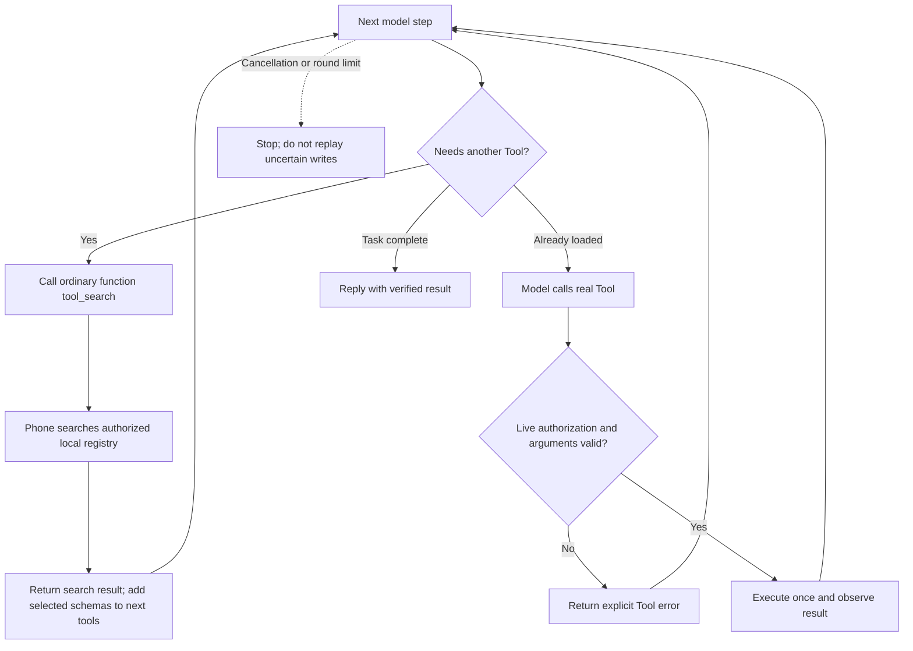

# Tool discovery and disclosure

This is the single authority for **which Tools the model sees, how
`tool_search` loads them, and how the model/tool loop continues**.
[Tool contracts](AGENT_TOOLS.md) owns individual executor schemas, provider
allowlists, permissions and side effects. [Technical design](TECHNICAL.md)
owns Provider transport and Skill document format. Do not copy their inventories
or execution policies here.

## 1. Scope and ownership

The implementation uses an ordinary function named **`tool_search`** on both
Chat Completions and Responses. There is no new connection setting, model-name
heuristic, automatic protocol switch, or remote search service.

The complete, enabled, actor-scoped `ToolRegistry` remains local. A separate
run-owned disclosure state starts with the base set below and adds selected
definitions after search. Being registered, enabled, model-visible, and
authorized to execute are different states.

- `ToolCatalogRepository` owns configuration and live availability.
- `ToolRegistry` owns immutable definitions, argument dispatch and availability
  checks; executors retain their existing live revision/permission checks.
- `EnglishToolSchemas` owns prepared model-facing annotation copies and their
  source-versioned derived cache, never original UI metadata or execution.
- `AgentOrchestrator` owns one disclosure state per run, continuation history,
  cancellation and existing round limits.
- Search metadata/indexes are derived from that registry, never another
  actor's registry. They contain no credentials or user documents.
- `MochiSkill.resolveTools` owns shared relation resolution for Skill readiness,
  loaded `allowed-tools` headers and Skill-scoped search.
- Skill readiness uses the full authorized registry, not the disclosed subset.
  Reading a Skill never enables a Tool or automatically loads a whole provider.

No Room/DataStore migration, additional network dependency, or change to the
foreground model-request deadline is required.

## 2. Base Tools

The foreground base allowlist has **25 entries including `tool_search`**.
Only entries actually available in the calling registry are disclosed.

| Purpose | Base Tools |
| --- | --- |
| Discovery and instructions | `tool_search`, `load_skill` |
| User assistance | `request_user_assistance` |
| Memory and Mochi navigation | `recall_memory`, `navigate_mochi_ui` |
| Personal planning | `manage_mochi_calendar`, `manage_mochi_schedule` |
| Local context | `get_current_location`, `get_current_weather` |
| Browser | `browser_read`, `browser_navigate`, `browser_click`, `browser_input`, `browser_scroll` |
| App Control | `app_read`, `app_navigate`, `app_click`, `app_input`, `app_scroll` |
| Media Control | `media_read`, `media_play_from_search`, `media_control`, `media_volume` |
| Computation and delegation | `run_sandboxed_javascript`, `delegate_agent` |

This list does **not** enable disabled groups, grant Android permissions, install
extensions, create logins, or change actor scope. In particular, memory still
requires Daily journal and children never gain delegation, App Control, or
Media Control merely because these names are in the foreground base list.
Scheduled/child runs use the intersection with their existing scoped registry.
`load_skill` exists only when that registry has usable Skills.

Every other authorized Tool is deferred: Amap, document-provider MCP Tools,
AgentLink, optional extensions, custom MCP and custom REST. Their individual
names and supported operations belong only in the executor/provider documents.
New Tools are deferred unless explicitly added to this base policy.

## 3. What the model sees

Initially the model receives base schemas, the existing lightweight Skill
metadata, and instructions to use `tool_search` for additional capabilities.
It does not receive every deferred Tool's name/description or any unselected
parameter schema. The model writes English capability queries containing the
service, operation and object, or an exact Tool name. It translates non-English
user wording itself; users can continue conversing in their preferred language.
This is schema/prompt guidance, not an ASCII or language-rejection rule.
The search entry does not embed the entire catalog.

Searching means **finding a Tool**, not executing it. For example, the query
"Tencent Docs add spreadsheet fields" loads the matching definition; it does
not create fields or contact a document API.

```mermaid
sequenceDiagram
    actor User
    participant Host as Mochi on phone
    participant LLM as Selected model
    participant Index as Local authorized Tool index
    participant Executor as Real Tool executor
    User->>Host: Task
    Host->>LLM: Base tools including tool_search; no deferred schemas
    LLM-->>Host: Call tool_search(query, limit)
    Host->>Index: Match names/descriptions and check live availability
    Index-->>Host: Selected complete definitions within budget
    Host->>Host: Add definitions to this run's visible set
    Host->>LLM: Search result + selected definitions in next request tools
    LLM-->>Host: Call a selected real Tool with arguments
    Host->>Host: Check visibility, live authorization and cancellation
    Host->>Executor: Validate and execute once
    Executor-->>Host: Typed result or explicit error
    Host->>LLM: Matching Tool result and same-run history
    LLM-->>Host: Continue, search again, or give evidence-based final reply
    Host-->>User: Verified result or honest limitation
```

Base Tools can be called immediately, skipping search. The complete Browser,
App and Media groups are therefore ready for common phone tasks without an
extra discovery round. A request to put the resulting shopping comparison into
a document may search for document Tools later in the same run.

## 4. Search and budgets

`tool_search` accepts a nonblank `query` (up to 512 characters), optional
integer `limit` (1-8, default 5), and optional `skill_name`. Unknown fields,
invalid types and empty queries return the normal `INVALID_ARGS` envelope.

### Skill-scoped search

`skill_name` is the exact standard name from this actor's visible Skill
metadata, identical to the name used by `load_skill`: 1-64 lowercase ASCII
letters/digits with single separating hyphens. It is a hard candidate filter,
not a ranking hint, authorization grant or request to load every associated
schema. Omission searches all currently available actor-owned Tools.

The English parameter description tells the model when and how to scope:

> Optional exact Skill name from Available Skills (same as load_skill), to narrow
> capability searches. Omit for exact Tool-name lookups or cross-Skill/unknown
> workflows. No global fallback. Does not require load_skill.

Exact-name lookups already rank first and do not need a Skill lookup; omitting
redundant scope avoids extra arguments and repository reads. If supplied anyway,
the scope still applies strictly.

For example:

```json
{"query":"Add fields to a smart table","skill_name":"tencent-docs-knowledge","limit":5}
```

The shared relation resolver combines original mandatory declarations,
explicit optional Tools and provider-associated names, intersected with the
actor's live available registry. Mandatory/any-provider readiness remains a
separate check; optional Tools never block readiness. Installed Skills without
Tool declarations have an empty scope, not unrestricted search. The host does
not infer associations from translated instructions or maintain a second map.

The model may read a Skill first for workflow guidance, but scoped search does
not force an additional `load_skill` round or translate its body. The last-read
Skill never implicitly changes later searches. The run gates lookup on its
visible Skill metadata and reloads the enabled original Skill before search
and before publication; relation changes or Skill edits/revocation during the
search return `STALE_REF` without loading new definitions.
Named lookup reads current overrides without rebuilding every Skill or reading
unrelated journal permissions. Name/dependency parsing stops at the closing
frontmatter delimiter instead of splitting instruction bodies. Neither
optimization caches live enablement.

| Condition | Result |
| --- | --- |
| Malformed/ambiguous name or invalid argument | `INVALID_ARGS` |
| Unknown, disabled or actor-unlisted Skill | `NOT_FOUND` |
| Skill's mandatory/provider requirements unavailable | `PERMISSION_DENIED` |
| Empty association set or no lexical match in scope | `NOT_FOUND`; explicit suggestion to refine or omit scope |
| Skill or resolved relationship changes while searching | `STALE_REF` |

No error silently falls back to global search. Exact names also obey the
scope; the model must make a separate broader search if appropriate. Scope
does not hide previously loaded Tools or replace execution-time authorization.
Results include `candidate_count` and, when specified, `skill_name`; names of
matches are returned once, without repeating descriptions already supplied in
the next request's full schemas.

### Skill Tool directories

`load_skill` returns its normal `name`, `location` and `content`. On the first
page, `content` contains the full English Skill document followed by a related
Tool directory. The directory includes only `resolveTools` associations that
are available to this actor and whose full definitions were **not supplied in
the invoking model request**. A Skill using only available base Tools has no
appendix or empty heading. The existing `allowed-tools` header is unchanged.

Each directory line is `name: description`. Names are complete; descriptions
come from the prepared English schema's top-level description, never another
translation or summary request. Whitespace is collapsed. Descriptions of at
most 100 Unicode code points are preserved; longer descriptions use at most
97 code points, ending at a word boundary when possible, followed by `...`.
The inclusive cap is 100 code points, not bytes or tokens. Full schemas and
their safety/argument constraints are never truncated by this directory.

The appendix explicitly says that entries are not callable schemas. The model
selects a name, calls `tool_search` with that exact name and `limit=1`, then
waits for the next request's full definition before executing. Capability
queries can still use BM25 with optional Skill scope. Initial Skill metadata
does not contain the directory, and loading a Skill never executes its Tools.

Entries are name-sorted. Each appendix page, including its heading and notice,
is bounded to 12 KiB UTF-8. A partial page includes `next_tool_cursor` alongside
`content`; passing it as `load_skill.tool_cursor` with the same `skill_name`
returns only the next directory page, not the Skill body again. The cursor
binds to the original Skill and current rendered directory contents. Skill
changes or changes to directory membership, excerpts or relevant disclosure
invalidate it with `STALE_REF`;
the caller must load again without the cursor. Malformed cursors return
`INVALID_ARGS`; pages never silently omit remaining entries.

The run-owned discovery layer supplies immutable actor definitions and the
actual request's supplied names. No global directory/permission cache or new
relationship map is maintained. `load_skill` retains its live Skill and
relationship revalidation before publication; search and execution keep their
own independent checks. Directory inclusion is not permission to execute.

The result remains in same-run Tool history. Later rounds do not append the
directory again automatically, but still carry the earlier result. Loading a
schema later does not rewrite old results to remove its directory line.
Reuse a previously loaded Skill unless its instructions or availability need
refreshing. This feature does not implement conversation-history compaction.

### Model-facing language and preparation

Tool descriptions and schema text annotations presented to the Agent are
English. UI/catalog source metadata remains separate and unchanged. Protocol
identifiers, property names, required lists, enum/const/default/example values,
references and validation constraints are preserved, including Chinese literals
required by an upstream API. This policy concerns instructions in schemas,
not user messages, business data or ordinary Tool results. Skill metadata and
the instruction-bearing `load_skill` result follow the
[English Skill contract](TECHNICAL.md#2-runtime).
Recognized annotations are `description`, `title`, `$comment`,
`markdownDescription`, `enumDescriptions`, `x-enumDescriptions` and
`x-enum-descriptions` at function/schema nodes. Arbitrary vendor fields are not
guessed to be prose; integrations must use these annotation fields.

`EnglishToolSchemas` prepares model-facing copies. English/Latin-script text
and punctuation are reused without a model call; this fast path is not a
semantic language classifier. Non-Latin text annotations use the active
connection with a standalone translation prompt, like the journal's isolated
generation path: only annotation IDs/texts are sent, with no persona, history,
memory, unrelated Skills, callable Tools, or complete schema. Skill preparation
reuses this mechanism with its own paragraph-translation prompt and cache-key
namespace. Source text is untrusted
translation data. The typed result must contain exactly the requested IDs and
English text. The host replaces only those annotations in the original
schema; it never accepts a model-generated replacement schema.
If an otherwise correctly identified response retains non-Latin text, one
additional isolated request rewrites only the affected annotations. Both
responses must satisfy the same final constraints; there is no unbounded retry
or language-validation bypass.

MCP connection/discovery/import and REST metadata updates warm the cache after
the configuration transaction, never inside it. Extensions, old configurations
and evicted cache entries are prepared before main/child registry construction.
Content-addressed app-private cache entries include the source schema and
translation-policy version in their key; source changes require preparation
again. Cache size and translation batches are bounded. Cancellation cannot
publish an unfinished result, and active Provider changes cancel translation.
The normal foreground model-request deadline remains unchanged.

Preparation errors surface explicitly and block Agent loading; there is no
fallback to untranslated instructions. Saved connection metadata is retained
if preparation fails and may be retried before use. Invalid derived cache entries
are removed with an explicit error; the next preparation attempt regenerates
them. Cache misses can consume model quota; English schemas and valid cache
hits do not. A final Agent-loop guard
rejects unprepared non-English annotations before any model request.

### Ranking and visibility budgets

Search is deterministic and local:

1. Filter to the current registry, live enabled/connected candidates and the
   optional resolved Skill scope.
2. Prefer exact names; split identifier separators/camel case and normalize
   case/Unicode. Index names and descriptions, not nested parameter prose.
3. Rank lexical matches with BM25 and a name boost. Include Chinese character
   bigrams and a small shared Chinese/English capability vocabulary. It is not
   an embedding model and must not pretend to understand arbitrary synonyms.
4. Select ranked complete definitions subject to count and serialized-byte
   budgets. Ties use stable names. Return loaded names and
   explicit no-match/omitted-budget information.

One immutable index is built per run. Scoped search skips excluded entries
before scoring and Top-K selection, while retaining full-registry document
frequencies and length statistics. It does not rebuild per-Skill indexes or
filter an already truncated global Top-K; eligible Tools keep their original
relative BM25 ordering. There are no embeddings, extra inference requests or
cross-run permission caches.

Budgets count compact UTF-8 JSON, including array separators, not characters
or a fixed number of bytes per token. The next request's visible Tool array
is bounded to 128 KiB; the foreground base set has a 32 KiB regression budget.
These are repository engineering thresholds, not Provider API/context limits
or experimentally established latency optima. The base threshold fails a
regression test rather than truncating definitions at runtime.
Admission reserves two extra bytes per ordinary function for the Responses
adapter's flattening/default `strict:false`, so the cap holds for both APIs.
Search never truncates a schema, deletes required fields, or loads the whole
catalog on a miss. An oversized candidate is explicitly reported; the model
can narrow the query or explain the limitation. Existing definitions are
deduplicated, and search results contain metadata rather than another copy of
the entire schema.

Within a run, loaded definitions remain available without searching again.
Each availability pass reads one catalog snapshot for the requested names,
and at most one live snapshot for each requested extension/AgentLink provider.
Main, scheduled and child registries intersect the answer with their own names;
Skill readiness uses the same batched path. Snapshots are local to a single
pass, never a cross-round permission cache. Search checks again before publishing
its selection, and execution still checks current permission for the individual
Tool before dispatch. Provider executors retain their own revision guards.
New top-level runs start with their own base set. A cancelled search cannot
publish new definitions. Disable/revocation removes visibility and blocks
execution; changing visibility is never an authorization grant. Unsupported
or undisclosed calls return explicit errors rather than guessing or silently
executing a Tool that the model has not loaded.

## 5. API continuation

Both current paths expose the same ordinary **function** named `tool_search`.
Both must return a result for the search call **and** put loaded definitions
in the next request's `tools`.

| Step | Chat Completions | Responses, ordinary-function path |
| --- | --- | --- |
| Search declaration | `type: function`, `function.name: tool_search` | Flattened `type: function`, `name: tool_search` |
| Model requests search | `assistant.tool_calls` | `function_call` |
| Host returns search result | `role: tool`, matching `tool_call_id` | `function_call_output`, matching `call_id` |
| Definitions become callable | Next request's `tools` | Next request's `tools` |
| Real Tool execution | Later `tool_calls` | Later `function_call` |

The search result alone is not a callable definition. Conversely, updating
`tools` without completing the search call breaks the conversation protocol.
Preserve all call/result associations, multiple calls in the same response,
and Responses reasoning/opaque continuation. Final-response repair remains
Tool-disabled. Calls may only use definitions supplied in the request that
produced them; a search cannot authorize a speculative sibling call in the
same model response.



Search shares existing Tool-round limits and cancellation. It is not business
evidence for cards. A timeout does not imply a write failed; existing executor
readback/idempotency rules remain authoritative.

## 6. Measurement and acceptance

The base-schema measurement must construct the real Kotlin Tool definitions,
not approximate source-code lengths. Record the ordinary Chat array and the
actual Responses-adapter array separately, including `tool_search`. Prompts,
Skill bodies, conversation history, results and HTTP headers are additional.
Do not convert byte counts into claimed model token usage without tokenization.

`BaseToolSchemasTest` constructs all real foreground base definitions with
fail-fast dependencies, asserts exact membership of the base policy, and
serializes both protocol arrays without executing any Tool or calling a model.
Current measurement (all 25 available; compact UTF-8 bytes):

| Set | Chat Completions | Responses |
| --- | ---: | ---: |
| Complete 25-entry base set | **21,105 bytes (20.61 KiB)** | **21,155 bytes (20.66 KiB)** |
| `tool_search` definition | 1,037 bytes | 1,039 bytes |

The largest individual Chat definitions are `manage_mochi_schedule`
(1,877 bytes), `navigate_mochi_ui` (1,824), and `recall_memory` (1,704).
Actual actor runs may send less when a base capability is unavailable.

The base array occupies about 65% of the 32 KiB regression budget and avoids a
discovery round for common Browser, App and Media tasks. Large or uncommon
provider schemas stay deferred.
This is a payload-size decision, not a measured token, accuracy or end-to-end
latency guarantee. The regression test fails if either protocol's actual base
array crosses 32 KiB; rerun it when a base schema changes.

Acceptance covers:

- All available base Tools work without search, including App and Media.
- Unrelated document schemas are absent initially, but discoverable by
  English capability queries and exact names. Non-English queries are not
  rejected by a character-set validator.
- Search returns its own result, the next request gains complete schemas,
  and real calls then execute on both supported APIs.
- Invalid/no-match/budget-limited searches, undisclosed calls, same-response
  speculative calls, cancellation, revocation and separate runs fail safely.
- Skill readiness remains based on full scoped availability.
- Optional Skill scope uses the shared relationship resolver, filters before
  Top-K, never widens silently, and rechecks edits/revocation before publication.
- Search results omit descriptions duplicated in next-request schemas.
- Skill directories include only related, available, undisclosed Tools;
  base-only Skills have no appendix. Excerpts respect the 100-code-point cap,
  complete definitions remain unchanged, and bounded pages reject stale cursors.
- Payload-size regression checks protect the base budget; end-to-end
  task latency/selection quality still need real deployment/device evaluation.

Small schemas reduce transfer overhead; they do not fix TCP/TLS delays or
guarantee every model request finishes before the unchanged foreground limit.

### Device measurements

Measured on 2026-11-21 with a Xiaomi M2012K11AC (alioth, ARM64), debug app
version 1.0.20, unchanged connections/permissions and warm English caches.
There were 74 catalog-ready Tools and 77 observed registry schemas.
Fixtures and opt-in reproduction instructions are in
[Development](../DEVELOPMENT.md). No private history/persona/memory is used.

**Description budget:** the current phone audit covers all 77 observed English
definitions, including 53 deferred Tools. Shipped optional extension and
AgentLink descriptions were also inspected; unconfigured remote catalogs are
not represented by phone measurements. Using the same whitespace/word-boundary
rule gives:

| Description cap | Deferred descriptions preserved in full | Combined excerpt bytes, excluding names/headings |
| --- | ---: | ---: |
| 60 characters | 33/53 | 2,795 |
| 80 characters | 36/53 | 3,155 |
| 100 characters | 38/53 | 3,514 |

The 100-character cap preserves the complete 92-character Amap route description
and 100-character place-search description. Tencent's routine descriptions
are mostly already below the cap; reducing to 80 saves only 70 bytes across its
35 directory lines and 359 excerpt bytes across all deferred Tools. These are
size/completeness observations, not a model-accuracy ablation of the three
lengths. Even 100 characters can omit multi-operation details and constraints;
the exact name and subsequently loaded full schema remain authoritative.

The current appendices include their heading/notice, but exclude the Skill
body and JSON envelope. All fit on one page:

| Skill | Deferred entries | Appendix UTF-8 bytes | Pure render median / P95 |
| --- | ---: | ---: | ---: |
| Tencent Docs | 35 | 3,441 (3.36 KiB) | 0.975 / 1.144 ms |
| Notion | 12 | 1,588 (1.55 KiB) | 2.365 / 3.741 ms |
| Travel planning | 5 | 632 (0.62 KiB) | 0.327 / 0.356 ms |
| Merchant discovery | 2 | 436 (0.43 KiB) | 0.257 / 0.395 ms |
| Nine base-only Skills | 0 each | 0 each | Each P95 below 0.04 ms |

Renderer measurements use five warmups and 100 samples per Skill, including
normalization/truncation and cursor revision work. They exclude live relation
resolution, Skill translation, model inference and network latency; they are
not whole-`load_skill` timings. Long source descriptions still require scanning
before truncation, so entry count alone does not predict render time.

**Paired retrieval:** 44 fixed English queries plus 53 generated exact names;
89 positive queries run both globally and with Skill scope, alternating pair
order. Eight no-dedicated-integration negatives run globally, for 186 searches.
Every observed ranking agrees with the in-memory index. All positive global
rankings remain unchanged by the directory addition; one negative query's
unrelated candidates change as the loader description changes corpus statistics.
Top-1/Top-5 mean one designated target ranks first/within five,
not exhaustive relevance precision or business-task success.

| Query group | Cases | Global Top-1 / Top-5 | Scoped Top-1 / Top-5 |
| --- | ---: | ---: | ---: |
| Explicit service + operation + object | 24 | 23/24 / 24/24 | 23/24 / 24/24 |
| Manually authored natural paraphrases | 12 | 1/12 / 7/12 | 2/12 / 8/12 |
| Exact deferred names | 53 | 53/53 / 53/53 | 53/53 / 53/53 |

Across the 36 descriptive queries, Top-5 target recall is **86.1% globally
and 88.9% scoped**. Scope removes cross-provider interference, not within-provider
lexical mismatches such as "columns"/"fields" and "rows"/"records".
The manually authored paraphrases are not queries generated by the main model.
Six of eight negative queries return generic/unrelated candidates; a nonempty
result is not proof of dedicated service support. Browser/App workarounds may
exist. This curated set is not a production accuracy estimate.

For the same 36 descriptive-query pairs:

| Metric | Global median / P95 | Scoped median / P95 |
| --- | ---: | ---: |
| Eligible candidates | 77 / 77 | 23.5 / 35 |
| Warm BM25 scoring | 0.130 / 0.166 ms | 0.102 / 0.137 ms |
| Search through next request's schema readiness | 41 / 51 ms | 61.5 / 74.75 ms |
| Search result envelope | 359 / 396 bytes | 375 / 434 bytes |
| Next-request Tool array | 27,607 / 71,946 bytes | 27,596.5 / 71,946 bytes |

BM25 measurements use five warmup passes and 720 timed samples per variant.
Host timings include current permission/schema checks and, for scope, fresh
Skill resolution and revalidation; they exclude factory work, model inference
and business execution. Scoping saves scoring work but adds about 20.5 ms to
the measured median host path. Exact-name queries should omit redundant scope.
Phone scheduling, GC and thermal state are not controlled; these are observations,
not latency guarantees.

**Payload:** for the same 36 descriptive queries, the current result envelopes
total 12,316 bytes globally and 13,385 bytes scoped. Adding duplicate descriptions
from the returned schemas to those same results would produce 35,018 and
35,987 bytes respectively: omitting duplication saves **64.8% / 62.8%**.
The next-request Tool arrays total 1,193,380 / 1,195,931 bytes; this set does not
establish schema-payload savings from scope alone. These are compact UTF-8 bytes,
not tokenizer counts or billed tokens. Scope narrows eligible Tools but does
not guarantee fewer matches, smaller definitions or a faster overall turn.

**Chinese request to main-model query:** 44 synthetic fixtures per arm,
132 measurements on the active `gpt-6.1-terra` connection, Responses, with the
then-current 20-second request deadline. Each arm receives the same capability-only
instruction followed by the Chinese request; labels remain hidden. The model
selects the final operation without missing-ID assistance or prerequisite
lookups. Only `load_skill`/`tool_search` can execute; observation stops at the
next request boundary after the first search batch.

Variant order rotates per fixture. Transport ablations remove Skills entirely,
retain Skills without the directory, or use the production directory. They
share the production registry/live checks; baseline host timings still include
directory preparation before its text is removed. This measures controlled
capability selection, not natural routing or completed business-task accuracy.

| Metric | No Skills | Skills only | Skills + directory |
| --- | ---: | ---: | ---: |
| Positive cases reaching search | 35/36 | 36/36 | 36/36 |
| Top-1 final target, all positive cases | 31/36 | 32/36 | 32/36 |
| Top-5 final target, all positive cases | 34/36 (94.4%) | 35/36 (97.2%) | 36/36 (100%) |
| Provider failures | 1 | 0 | 0 |
| Negative queries returning generic/unrelated candidates | 6/8 | 6/8 | 6/8 |
| English search queries | 43/43 | 44/44 | 44/44 |
| Cases requesting a Skill / receiving directory text | 0 / 0 | 10 / 0 | 8 / 3 |
| Total model requests | 44 | 49 | 47 |
| Total serialized request-representation bytes | 1,057,824 | 1,391,614 | 1,337,781 |

The no-Skills failure was a network exception after 20,019 ms; it remains in
the all-positive denominator. Conditional on reaching search, its Top-1/Top-5
are 31/35 and 34/35. No cases replied without search or attempted business calls.
The four Tencent paraphrases hit 3/4, 3/4 and 4/4 respectively; appending a row
missed in the first two arms. All three cases that actually received a
directory selected an exact name and hit rank one. The row-query improvement
occurred without directory exposure, so it must not be attributed to reading
the appendix. This single small run does not isolate causal benefit or model
variance. Negative-query precision remains a limitation in every arm.

| Live latency, median / P95 | No Skills | Skills only | Skills + directory |
| --- | ---: | ---: | ---: |
| Individual model request | 2,332 / 3,346.65 ms | 2,329 / 3,396.6 ms | 2,246 / 3,126.5 ms |
| Search response through next request readiness | 67 / 86.1 ms | 71.5 / 143.55 ms | 68.5 / 131.05 ms |
| Agent start through search results, excluding factory | 2,490 / 3,347.6 ms | 2,699.5 / 4,651.85 ms | 2,467 / 3,738.55 ms |

Model-request samples are 44/49/47; search-path samples are 43/44/44 and exclude
the failed case. Live host timings can include same-response Skill loads and
multiple searches; stage medians are not additive. Directory-arm aggregate
request representation is 3.9% smaller than Skills-only because the observed
run uses two fewer model requests, not because descriptions are free.
Skills-only and directory arms both exceed the no-Skills payload. These counts
serialize the shared Chat request representation, not Responses wire bytes or
billed tokens. No tokens/s, server threads/memory, throughput or sustained
latency improvement is established by this client-side experiment.

| Connected-phone validation | Observed result |
| --- | --- |
| English Skill inputs | All 13 enabled Skills pass |
| Live read-only weather | Search, next-request schema, one Shanghai Amap call and final reply pass |
| Authorized browser/document task | Taobao search pages read; Tencent Smart Canvas created, updated and read back |
| Product qualification and cart | Detail pages did not open; no verified qualifying minimum price/product link, and no cart addition |

The shopping goal remains blocked, not a passed purchase workflow. Search-page
prices in the task document are explicitly unverified. No order or payment was
made; the document-target guard also passes a separate no-business-call test.
Account data, real document identifiers and shopping evidence stay out of the
repository. This does not certify arbitrary provider writes.
