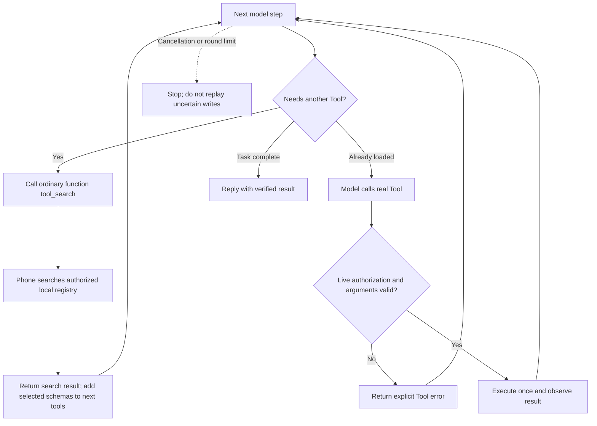

# Tool discovery and disclosure

This is the single authority for **which Tools the model sees, how
`tool_search` loads them, and how the model/tool loop continues**.
[Tool contracts](AGENT_TOOLS.md) owns individual executor schemas, provider
allowlists, permissions and side effects. [Technical design](TECHNICAL.md)
owns Provider transport and Skill document format. Do not copy their inventories
or execution policies here.

## 1. Scope and ownership

The implementation uses an ordinary function named **`tool_search`** on both
Chat Completions and Responses. There is no new connection setting, model-name
heuristic, automatic protocol switch, or remote search service.

The complete, enabled, actor-scoped `ToolRegistry` remains local. A separate
run-owned disclosure state starts with the base set below and adds selected
definitions after search. Being registered, enabled, model-visible, and
authorized to execute are different states.

- `ToolCatalogRepository` owns configuration and live availability.
- `ToolRegistry` owns immutable definitions, argument dispatch and availability
  checks; executors retain their existing live revision/permission checks.
- `EnglishToolSchemas` owns prepared model-facing annotation copies and their
  source-versioned derived cache, never original UI metadata or execution.
- `AgentOrchestrator` owns one disclosure state per run, continuation history,
  cancellation and existing round limits.
- Search metadata/indexes are derived from that registry, never another
  actor's registry. They contain no credentials or user documents.
- Skill readiness uses the full authorized registry, not the disclosed subset.
  Reading a Skill never enables a Tool or automatically loads a whole provider.

No Room/DataStore migration, additional network dependency, or change to the
20-second foreground model-request deadline is required.

## 2. Base Tools

The foreground base allowlist has **25 entries including `tool_search`**.
Only entries actually available in the calling registry are disclosed.

| Purpose | Base Tools |
| --- | --- |
| Discovery and instructions | `tool_search`, `load_skill` |
| User assistance | `request_user_assistance` |
| Memory and Mochi navigation | `recall_memory`, `navigate_mochi_ui` |
| Personal planning | `manage_mochi_calendar`, `manage_mochi_schedule` |
| Local context | `get_current_location`, `get_current_weather` |
| Browser | `browser_read`, `browser_navigate`, `browser_click`, `browser_input`, `browser_scroll` |
| App Control | `app_read`, `app_navigate`, `app_click`, `app_input`, `app_scroll` |
| Media Control | `media_read`, `media_play_from_search`, `media_control`, `media_volume` |
| Computation and delegation | `run_sandboxed_javascript`, `delegate_agent` |

This list does **not** enable disabled groups, grant Android permissions, install
extensions, create logins, or change actor scope. In particular, memory still
requires Daily journal and children never gain delegation, App Control, or
Media Control merely because these names are in the foreground base list.
Scheduled/child runs use the intersection with their existing scoped registry.
`load_skill` exists only when that registry has usable Skills.

Every other authorized Tool is deferred: Amap, document-provider MCP Tools,
AgentLink, optional extensions, custom MCP and custom REST. Their individual
names and supported operations belong only in the executor/provider documents.
New Tools are deferred unless explicitly added to this base policy.

## 3. What the model sees

Initially the model receives base schemas, the existing lightweight Skill
metadata, and instructions to use `tool_search` for additional capabilities.
It does not receive every deferred Tool's name/description or any unselected
parameter schema. The model writes English capability queries containing the
service, operation and object, or an exact Tool name. It translates non-English
user wording itself; users can continue conversing in their preferred language.
This is schema/prompt guidance, not an ASCII or language-rejection rule.
The search entry does not embed the entire catalog.

Searching means **finding a Tool**, not executing it. For example, the query
"Tencent Docs add spreadsheet fields" loads the matching definition; it does
not create fields or contact a document API.

```mermaid
sequenceDiagram
    actor User
    participant Host as Mochi on phone
    participant LLM as Selected model
    participant Index as Local authorized Tool index
    participant Executor as Real Tool executor
    User->>Host: Task
    Host->>LLM: Base tools including tool_search; no deferred schemas
    LLM-->>Host: Call tool_search(query, limit)
    Host->>Index: Match names/descriptions and check live availability
    Index-->>Host: Selected complete definitions within budget
    Host->>Host: Add definitions to this run's visible set
    Host->>LLM: Search result + selected definitions in next request tools
    LLM-->>Host: Call a selected real Tool with arguments
    Host->>Host: Check visibility, live authorization and cancellation
    Host->>Executor: Validate and execute once
    Executor-->>Host: Typed result or explicit error
    Host->>LLM: Matching Tool result and same-run history
    LLM-->>Host: Continue, search again, or give evidence-based final reply
    Host-->>User: Verified result or honest limitation
```

Base Tools can be called immediately, skipping search. The complete Browser,
App and Media groups are therefore ready for common phone tasks without an
extra discovery round. A request to put the resulting shopping comparison into
a document may search for document Tools later in the same run.

## 4. Search and budgets

`tool_search` accepts a nonblank `query` (up to 512 characters) and optional
integer `limit` (1-8, default 5). Unknown fields, invalid types and empty
queries return the normal `INVALID_ARGS` envelope.

### Model-facing language and preparation

Tool descriptions and schema text annotations presented to the Agent are
English. UI/catalog source metadata remains separate and unchanged. Protocol
identifiers, property names, required lists, enum/const/default/example values,
references and validation constraints are preserved, including Chinese literals
required by an upstream API. This policy concerns instructions in schemas,
not user messages, Skill content, business data or Tool results.
Recognized annotations are `description`, `title`, `$comment`,
`markdownDescription`, `enumDescriptions`, `x-enumDescriptions` and
`x-enum-descriptions` at function/schema nodes. Arbitrary vendor fields are not
guessed to be prose; integrations must use these annotation fields.

`EnglishToolSchemas` prepares model-facing copies. English/Latin-script text
and punctuation are reused without a model call; this fast path is not a
semantic language classifier. Non-Latin text annotations use the active
connection with a standalone translation prompt, like the journal's isolated
generation path: only annotation IDs/texts are sent, with no persona, history,
memory, Skills, callable Tools, or complete schema. Source text is untrusted
translation data. The typed result must contain exactly the requested IDs and
English text. The host replaces only those annotations in the original
schema; it never accepts a model-generated replacement schema.

MCP connection/discovery/import and REST metadata updates warm the cache after
the configuration transaction, never inside it. Extensions, old configurations
and evicted cache entries are prepared before main/child registry construction.
Content-addressed app-private cache entries include the source schema and
translation-policy version in their key; source changes require preparation
again. Cache size and translation batches are bounded. Cancellation cannot
publish an unfinished result, and active Provider changes cancel translation.
The normal foreground model-request deadline remains unchanged.

Preparation errors surface explicitly and block Agent loading; there is no
fallback to untranslated instructions. Saved connection metadata is retained
if preparation fails and may be retried before use. Invalid derived cache entries
are removed with an explicit error; the next preparation attempt regenerates
them. Cache misses can consume model quota; English schemas and valid cache
hits do not. A final Agent-loop guard
rejects unprepared non-English annotations before any model request.

### Ranking and visibility budgets

Search is deterministic and local:

1. Filter to the current registry and live enabled/connected candidates.
2. Prefer exact names; split identifier separators/camel case and normalize
   case/Unicode. Index names and descriptions, not nested parameter prose.
3. Rank lexical matches with BM25 and a name boost. Include Chinese character
   bigrams and a small shared Chinese/English capability vocabulary. It is not
   an embedding model and must not pretend to understand arbitrary synonyms.
4. Select ranked complete definitions subject to count and serialized-byte
   budgets. Ties use stable names. Return loaded names, descriptions and
   explicit no-match/omitted-budget information.

Budgets count compact UTF-8 JSON, including array separators, not characters
or a fixed number of bytes per token. The next request's visible Tool array
is bounded to 128 KiB; the foreground base set has a 32 KiB regression budget.
These are repository engineering thresholds, not Provider API/context limits
or experimentally established latency optima. The base threshold fails a
regression test rather than truncating definitions at runtime.
Admission reserves two extra bytes per ordinary function for the Responses
adapter's flattening/default `strict:false`, so the cap holds for both APIs.
Search never truncates a schema, deletes required fields, or loads the whole
catalog on a miss. An oversized candidate is explicitly reported; the model
can narrow the query or explain the limitation. Existing definitions are
deduplicated, and search results contain metadata rather than another copy of
the entire schema.

Within a run, loaded definitions remain available without searching again.
New top-level runs start with their own base set. A cancelled search cannot
publish new definitions. Disable/revocation removes visibility and blocks
execution; changing visibility is never an authorization grant. Unsupported
or undisclosed calls return explicit errors rather than guessing or silently
executing a Tool that the model has not loaded.

## 5. API continuation

Both current paths expose the same ordinary **function** named `tool_search`.
Both must return a result for the search call **and** put loaded definitions
in the next request's `tools`.

| Step | Chat Completions | Responses, ordinary-function path |
| --- | --- | --- |
| Search declaration | `type: function`, `function.name: tool_search` | Flattened `type: function`, `name: tool_search` |
| Model requests search | `assistant.tool_calls` | `function_call` |
| Host returns search result | `role: tool`, matching `tool_call_id` | `function_call_output`, matching `call_id` |
| Definitions become callable | Next request's `tools` | Next request's `tools` |
| Real Tool execution | Later `tool_calls` | Later `function_call` |

The search result alone is not a callable definition. Conversely, updating
`tools` without completing the search call breaks the conversation protocol.
Preserve all call/result associations, multiple calls in the same response,
and Responses reasoning/opaque continuation. Final-response repair remains
Tool-disabled. Calls may only use definitions supplied in the request that
produced them; a search cannot authorize a speculative sibling call in the
same model response.



Search shares existing Tool-round limits and cancellation. It is not business
evidence for cards. A timeout does not imply a write failed; existing executor
readback/idempotency rules remain authoritative.

## 6. Native Responses search: deferred follow-up

Native client search is **not part of this implementation**. It would declare
`type: tool_search`, `execution: client`, receive `tool_search_call`, and return
definitions in `tool_search_output.tools` inside the next `input`. Those
definitions need not be duplicated in top-level `tools`. It requires typed
search items, namespace mapping and deployment compatibility verification.

Hosted search is different again: it declares the candidate definitions
up front with `defer_loading`. Saving model context does not remove that
initial upload. See [Azure Responses tool search](https://learn.microsoft.com/en-us/azure/foundry/openai/how-to/tool-search).
Do not pass either native protocol into the ordinary function path or change
Provider settings based on a timeout.

## 7. Measurement and acceptance

The base-schema measurement must construct the real Kotlin Tool definitions,
not approximate source-code lengths. Record the ordinary Chat array and the
actual Responses-adapter array separately, including `tool_search`. Prompts,
Skill bodies, conversation history, results and HTTP headers are additional.
Do not convert byte counts into claimed model token usage without tokenization.

`BaseToolSchemasTest` constructs all real foreground base definitions with
fail-fast dependencies, asserts exact membership of the base policy, and
serializes both protocol arrays without executing any Tool or calling a model.
Measured baseline (all 25 available; compact UTF-8 bytes):

| Set | Chat Completions | Responses |
| --- | ---: | ---: |
| 16 entries, before adding App and Media | 15,365 bytes (15.00 KiB) | 15,397 bytes (15.04 KiB) |
| 25 entries, including App and Media | **20,747 bytes (20.26 KiB)** | **20,797 bytes (20.31 KiB)** |
| Added cost of App + Media | 5,382 bytes | 5,400 bytes |

The largest individual Chat definitions are `manage_mochi_schedule`
(1,877 bytes), `navigate_mochi_ui` (1,824), and `recall_memory` (1,704).
`tool_search` itself is 882 bytes in Chat and 884 in Responses.
Actual actor runs may send less when a base capability is unavailable.

**Conclusion: keep the expanded 25-entry base set.** Its maximum measured
array occupies about 63% of the 32 KiB regression budget and avoids a discovery
round for common Browser, App and Media tasks. The nine added App/Media entries
cost only about 5.3 KiB. Large or uncommon provider schemas stay deferred.
This is a payload-size decision, not a measured token, accuracy or end-to-end
latency guarantee. The regression test fails if either protocol's actual base
array crosses 32 KiB; rerun it when a base schema changes.

Acceptance covers:

- All available base Tools work without search, including App and Media.
- Unrelated document schemas are absent initially, but discoverable by
  English capability queries and exact names. Non-English queries are not
  rejected by a character-set validator.
- Search returns its own result, the next request gains complete schemas,
  and real calls then execute on both supported APIs.
- Invalid/no-match/budget-limited searches, undisclosed calls, same-response
  speculative calls, cancellation, revocation and separate runs fail safely.
- Skill readiness remains based on full scoped availability.
- Payload-size regression checks protect the base budget; end-to-end
  task latency/selection quality still need real deployment/device evaluation.

Small schemas reduce transfer overhead; they do not fix TCP/TLS delays or
guarantee every model request finishes before the unchanged foreground limit.
